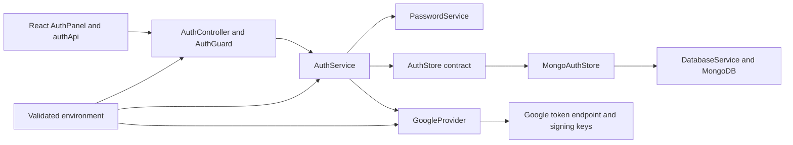

# Authentication module architecture

Authentication supports email/password registration and sign-in, Google OAuth 2.0 / OpenID Connect, current-user lookup, and sign-out. Both methods create opaque, revocable sessions persisted in MongoDB. The React client includes registration/sign-in forms, Google navigation, session restoration, and sign-out.

[RecoveryModule](../apps/api/src/modules/auth/recovery.module.ts) adds owner session listing/revocation and a controlled reset/verification delivery boundary. **Live email delivery is disabled by user choice.** Reset eligibility requires a verified email and an existing password; provider-only identities keep their original sign-in method. [Recovery contracts](DEMO_ENHANCEMENTS.md#identity-recovery-and-sessions) define hashed expiring single-use tokens, concurrent-consumption fencing and transactional password replacement/session revocation. Automated cases use an isolated inbox, never external sign-in or real email delivery.

## Responsibilities and boundaries

`AuthModule` is the identity/session boundary inside the NestJS modular monolith. It owns credential verification, provider identity resolution, session creation/revocation, authentication guards, authentication CSRF protection, and login throttling. Other feature modules resolve the caller through the exported `AuthGuard` or `AuthService` and enforce authorization for their own resources. Account balances, asset issuance, transfers, and chat belong to their respective modules.

The API uses the global `EnvironmentModule` and `DatabaseModule`. The shared HTTP bootstrap in `apps/api/src/configure-http.ts` applies the `/api` prefix, Helmet, CORS, and validation settings to both the running application and auth integration scenarios.



## Components and dependencies

Auth filenames below are relative to `apps/api/src/modules/auth/`; other paths are relative to the repository root.

| Component / source                | Responsibility                                                                                                        |
| --------------------------------- | --------------------------------------------------------------------------------------------------------------------- |
| `auth.module.ts`                  | Registers controllers/providers, binds `AuthStore` to `MongoAuthStore`, and exports `AuthService`/`AuthGuard`         |
| `auth.controller.ts`              | HTTP endpoints, write checks, safe responses, cookies, and fixed-origin redirects                                     |
| `auth.service.ts`                 | Sign-up/sign-in orchestration, session lifecycle, rate limits, and single-use Google flows                            |
| `auth.guard.ts`                   | Validates the session and active user, then attaches authenticated identity to the request                            |
| `auth.models.ts`                  | User/session/OAuth records and the abstract persistence contract                                                      |
| `mongo-auth.store.ts`             | MongoDB queries, validators/index initialization, duplicate handling, atomic OAuth consumption, and rate counters     |
| `auth.validation.ts`              | Zod input schemas, email/handle normalization, and rejection of unknown request fields                                |
| `auth.crypto.ts`                  | Argon2id password operations, random tokens, token hashing, and session-bound CSRF derivation                         |
| `auth.http.ts`                    | Cookie names/options, parsing, origin validation, and CSRF enforcement                                                |
| `google.provider.ts`              | Google authorization URLs, code exchange, signature/claim verification, and sanitized provider failures               |
| `identity-eligibility.service.ts` | Narrow public peer projection and transaction-aware active-user revision fence for settlement                         |
| `apps/web/src/AuthPanel.tsx`      | Client forms, session restoration, Google navigation, status/error display, and sign-out; identity shared through App |
| `apps/web/src/auth.ts`            | Typed API calls, cookie credentials, timeouts, and CSRF-before-write sequencing                                       |
| `packages/contracts/src/index.ts` | Public user, request, and response contracts shared by client and API                                                 |

The module uses the official MongoDB driver, `@node-rs/argon2` for Argon2id, `jose` for RS256/JWK verification, `cookie` for cookie handling, and native `fetch` for Google token exchange. The `GOOGLE_HTTP` and `GOOGLE_KEYS` injection tokens let tests replace the external network and signing-key source while exercising the real provider verification logic. Exact dependency versions are recorded in the manifests and lockfile.

## Main flows and decisions

1. **Email registration:** the controller enforces origin/CSRF and IP limits, validates/normalizes input, and calls the service. The service hashes the password and inserts a user through the store. Unique indexes reject duplicate identities, including concurrent requests. It creates a session, revokes any previous browser session, and returns the public user with new cookies.
2. **Email sign-in:** after the same HTTP checks, the service enforces an email-specific limit, loads the user, verifies the password, and checks active status. Unknown emails use a dummy password hash and the same public failure message. Success creates a fresh session and revokes the previous browser session.
3. **Google sign-in:** the service saves a short-lived attempt and the controller sets its browser binding cookie. The browser visits Google and returns to the fixed callback. The store atomically consumes a matching, unexpired attempt before token exchange. The provider verifies the ID token; the service resolves the stable Google subject or creates a separate verified user, then creates the same application session used by email authentication. A matching email alone never links accounts.
4. **Session restoration and protected requests:** the browser sends the HttpOnly session cookie. `AuthGuard` calls `AuthService.authenticate`, which hashes the token, queries an unexpired/unrevoked session, and loads an active user. Subsequent feature modules use this server-derived identity when enforcing their resource permissions.
5. **Sign-out:** a valid session plus origin/CSRF checks allow the service to revoke the stored token hash; the controller clears the session and CSRF cookies. TTL deletion is asynchronous cleanup, so expiry/revocation remain explicit query conditions.

An opaque database-backed session keeps revocation authoritative on the server and gives both identity providers the same application authentication behavior. The persistence contract supports isolated unit fixtures; functional scenarios use `MongoAuthStore` against real temporary databases. Mongo persistence now creates each new user and one application wallet in a snapshot/majority transaction, shared by email and Google registration. A wallet insert failure rolls back the user. Session creation and prior-session revocation remain sequential afterward; the user and wallet may remain if later session creation fails. Sign-in does not create wallets for legacy identities or issue balances. See [wallet architecture](WALLETS.md) for backfill requirements.

## Data owned by the module

| Collection       | Core fields and purpose                                                                                                                        | Constraints / cleanup                                                                      |
| ---------------- | ---------------------------------------------------------------------------------------------------------------------------------------------- | ------------------------------------------------------------------------------------------ |
| `users`          | Normalized email, public handle, display name, optional password hash or Google subject, verification flag, active/disabled status, timestamps | Unique email/handle; unique Google subject when present; MongoDB validation                |
| `sessions`       | User ID, token hash, creation/expiry timestamps, nullable revocation timestamp                                                                 | Unique token hash; user lookup index; TTL on expiry; explicit validity checks              |
| `oauthAttempts`  | Hashed state ID, browser binding hash, PKCE verifier, nonce, expiry                                                                            | Single-use matching through atomic deletion; ten-minute application expiry and TTL cleanup |
| `authRateLimits` | Hashed identity/window ID, attempt count, expiry                                                                                               | Atomic increments; fixed-window IDs; TTL cleanup                                           |

The public response is an explicit projection of the user record. Raw session tokens are delivered only in HttpOnly cookies. Provider access/refresh tokens are discarded. See the HTTP contract and protection sections below for exact external behavior, validation, and current limits.

## Local setup

Email sign-in works with the existing root `.env`; new settings have defaults. Start local MongoDB and the development servers:

```powershell
.\scripts\db.ps1 start
.\scripts\npm.ps1 run dev
```

Use <http://localhost:5173>, matching `WEB_ORIGIN`. An email registration requires an email, a public handle of 3–24 ASCII letters/numbers/underscores starting with a letter, and a password of 12–128 characters. Email and handles are trimmed and lowercased; passwords are preserved. Email registration does not prove inbox ownership: these accounts have `emailVerified: false`.

To enable Google, create an OAuth client of type **Web application** in Google Cloud and configure its consent screen and test users as applicable. Register this exact development redirect URI:

```text
http://localhost:5173/api/auth/google/callback
```

Set all three variables in the ignored root `.env` and restart the API:

```dotenv
GOOGLE_CLIENT_ID=your-web-client-id
GOOGLE_CLIENT_SECRET=your-web-client-secret
GOOGLE_REDIRECT_URI=http://localhost:5173/api/auth/google/callback
```

Keep credentials out of commits, logs, screenshots, and chat. The callback uses Vite's `/api` proxy so cookies are set on the web application's host. Google remains unavailable when all three settings are empty; email authentication continues to work. Partial Google configuration fails startup. See [Google's OpenID Connect setup](https://developers.google.com/identity/openid-connect/openid-connect#settingupop) for provider configuration.

| Setting                | Default / requirement                                      |
| ---------------------- | ---------------------------------------------------------- |
| `WEB_ORIGIN`           | Exact allowed web origin, without a trailing slash or path |
| `SESSION_TTL_SECONDS`  | `604800` (7 days), configurable from 60 seconds to 30 days |
| `GOOGLE_CLIENT_ID`     | Optional, together with the secret and callback URL        |
| `GOOGLE_CLIENT_SECRET` | Server-side secret, never sent to the client               |
| `GOOGLE_REDIRECT_URI`  | Exact registered `/api/auth/google/callback` URL           |

## HTTP contract

All paths below use the existing `/api` prefix. Auth responses disable caching.

| Method / route              | Behavior                                                                                           |
| --------------------------- | -------------------------------------------------------------------------------------------------- |
| `GET /auth/providers`       | `{ email: true, google: boolean }`                                                                 |
| `GET /auth/csrf`            | Sets an HttpOnly CSRF cookie and returns `{ csrfToken }`                                           |
| `POST /auth/signup`         | `{ email, publicHandle, password }`; returns 201 with `{ user }` and session cookies               |
| `POST /auth/signin`         | `{ email, password }`; returns 200 with `{ user }` and new session cookies                         |
| `GET /auth/me`              | Returns `{ user }`, or 401 without a valid active session                                          |
| `POST /auth/signout`        | Revokes the current session, clears cookies, and returns 204; requires a valid session             |
| `GET /auth/google`          | Sets a browser binding cookie and redirects to Google's authorization endpoint; 503 when disabled  |
| `GET /auth/google/callback` | Consumes the OAuth attempt, verifies identity, sets session cookies, and redirects to `WEB_ORIGIN` |

Before each POST, fetch `/auth/csrf` with cookies enabled. Send its token as `X-CSRF-Token`, the browser's matching cookies, and `Origin: <WEB_ORIGIN>`. The web client handles this sequence. A valid current session additionally binds the CSRF token to that session using HMAC-SHA256. JSON request objects reject unknown fields.

Public user fields are `id`, `email`, `publicHandle`, `displayName`, `emailVerified`, and `signInMethod`. Password hashes, provider subjects, raw session tokens, and internal records are excluded. Errors use 400 for invalid input, 401 for failed/expired authentication, 403 for invalid CSRF/origin, 409 for duplicate identities, and 429 for throttling. Sign-in errors do not distinguish unknown email from wrong password.

Google failures redirect to the fixed web origin with `auth_error=google_failed`; an existing account requiring its original method uses `auth_error=account_exists`. The client displays a message and removes the error parameter. Redirect destinations cannot be supplied by the requester.

## Persistence and protection

- Passwords use Argon2id with independent salts, 19 MiB memory, two iterations, and one lane. Unknown-email verification uses a dummy hash.
- Sessions use 256-bit random tokens. Only SHA-256 token hashes are stored. Sign-in creates a new token and revokes the browser's prior session. Session expiry, revocation, and account status are checked on every protected request; MongoDB TTL cleanup is not an authorization check.
- Cookies use HttpOnly, SameSite=Lax, and Path=/ without Domain. Production requires HTTPS configuration and uses Secure cookies with `__Host-` names. Local HTTP development omits Secure.
- MongoDB validators and indexes are created before accepting traffic. Users have unique normalized email, handle, and Google subject indexes; sessions have unique token hashes and expiry indexes. OAuth attempts and rate-limit buckets also expire.
- Auth attempts are limited to 30 per client IP per 15-minute bucket, with an additional 10 sign-ins per normalized email per bucket. Counters are shared through MongoDB. The API currently trusts no forwarded IP headers; configure and verify a trusted proxy policy before production deployment to avoid grouping all proxy clients into one IP bucket.
- Google uses authorization code + S256 PKCE, browser-bound random state, a random nonce, and ten-minute single-use attempts consumed atomically. ID tokens require a valid RS256 signature from Google's cached JWK set, accepted issuer, configured audience, current expiry/issued-at, matching nonce, and verified email. Access/refresh tokens are not retained.
- Google accounts are identified by stable subject. A matching email never automatically links a Google identity to an existing password account. Generated Google handles are unique opaque identifiers. Returning users keep their stored email/handle even if Google's email changes.

Email verification delivery, password reset, magic links, account linking, session management screens, and socket authentication are future work. Future protected REST modules should reuse `AuthGuard`; sockets must validate sessions and revocation separately. Production hosting and live Google consent have not been verified by the automated suites.

## Wallet and Transfer integration

Wallet/peer/transfer routes reuse `AuthGuard`; transfer POST explicitly calls `requireCsrf` with `request.auth.token`. The guard alone does not enforce CSRF. Peer responses use the separate minimal `PublicPeer` projection, because `AuthUser` includes email. See the [Wallet and Transfer LLD](WALLET_AND_TRANSFER_LLD.md) and [QA map](WALLET_AND_TRANSFER_QA.md) for exact contracts and current verification.

`IdentityEligibility` is exported by AuthModule. It increments optional BSON Long `transferEligibilityRevision` conditional on active status using the settlement's `ClientSession`. Existing users need no backfill: an absent field increments from zero. Supported suspension writes the same user record, ordering it with settlement through transaction conflicts. Profiles expose only public ID/handle/name. The existing user validator accepts the optional revision; the public authentication response excludes it. Ordinary sign-up/sign-in never issues assets. App now shares authenticated identity with AuthPanel and WalletPanel; sign-out, account change and 401 clear private wallet/intent state. Auth behavior remains subject to the complete regression suites.

## Tests

```powershell
.\scripts\db.ps1 start
.\scripts\npm.ps1 run check
```

Unit tests use isolated in-memory repository fixtures and locally signed Google tokens. Auth Cucumber scenarios use the actual application/bootstrap configuration and real local MongoDB, with a unique `p2p_auth_test_<random-id>` database per scenario. Cleanup verifies the generated name before dropping that database; application data is untouched. Only Google HTTP and its verification keys are substituted. Health scenarios retain their existing controlled database fixture.

Scenarios cover happy, negative, and edge cases for registration, duplicate identities and concurrent registration, validation boundaries, sign-in, sign-out, session rotation/expiry/revocation/disabled users, CSRF/origin checks, rate limiting, Google verification/cancellation/state expiry/replay, returning users, identity separation, and unconfigured Google. JUnit XML and Cucumber HTML reports remain under `.local/test-results/`.

See [the testing guide](../tests/README.md), [Google OIDC](https://developers.google.com/identity/openid-connect/openid-connect), [JOSE JWT verification](https://github.com/panva/jose), and [OWASP password storage](https://cheatsheetseries.owasp.org/cheatsheets/Password_Storage_Cheat_Sheet.html).
