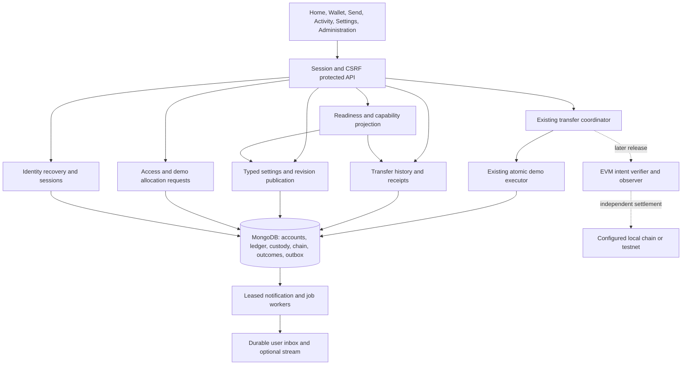

# P2P business capabilities and API enhancement HLD

Design snapshot: 26 October 2026. The user subsequently authorized core packages P00–P08. [Implementation architecture and acceptance gates](DEMO_ENHANCEMENTS.md) distinguish implemented source, tests and live evidence. P09/P10 remain separate work.

Read with the [consumer experience plan](CONSUMER_EXPERIENCE_PLAN.md) and [sequential agent delivery plan](ENHANCEMENT_DELIVERY_PLAN.md). The [parent HLD](HIGH_LEVEL_DESIGN.md), [wallet overhaul HLD](WALLET_ASSET_OVERHAUL_HLD.md) and [overhaul LLD](WALLET_ASSET_OVERHAUL_LLD.md) retain settlement invariants. This document adds business completion, recovery and configuration contracts. Where older target routes differ from deployed routes, preserve deployed contracts and introduce additive capabilities.

## 1. Business purpose and scope

**Product promise:** a registered person can understand what they own, send a supported asset to the intended peer, find the outcome later, and recover from interruptions without losing control or accidentally sending twice. An operator can configure and support those journeys from a permissioned UI.

The current product is a server-coordinated demo asset service. Demo units have no monetary value. Linking an external address proves control of that address; it neither loads a spendable crypto balance nor enables payments. Internet/server connectivity is required for settlement. These distinctions must remain visible in every relevant screen and API contract.

| Actor                   | Business job                                                      | Successful outcome                                                              |
| ----------------------- | ----------------------------------------------------------------- | ------------------------------------------------------------------------------- |
| New consumer            | Understand setup, supported assets and how to get started         | Sees readiness and a useful next action without reading deployment instructions |
| Sender                  | Select the correct peer, review and send                          | One durable outcome, clear receipt and no accidental duplicate effect           |
| Recipient               | Receive while signed out and find the receipt later               | Receives without accepting a chat invitation or being online                    |
| Returning consumer      | Find a transfer after refresh, logout or another device           | Server history recovers admitted work independently of browser storage          |
| Asset administrator     | Configure assets, limits, networks and supported product policies | Validated, revisioned, auditable changes with explained impact                  |
| Access administrator    | Grant/revoke access and manage account restrictions               | Least privilege, last-admin protection and understandable request status        |
| Demo operator / auditor | Prepare repeatable demonstrations / inspect evidence              | Balanced fixtures, bounded jobs and read-only financial evidence                |

The first release should complete the demo consumer journey. Local-chain and testnet payments are a separate release using the existing EVM design. Mainnet, fees, exchange rates, fiat funding, cash-out, escrow, scheduled payments, NFTs and true offline settlement are outside this plan's first release. There is no evidence to justify a monetization model or projected revenue yet. Measure task completion and support demand before expanding scope.

## 2. Evidence and current gaps

Reviewed branch `feature/Auth`, commit `4ba85481807384e3be1d4e1622cb7484d0bf380c`; tracked worktree was clean before this documentation session. The older handover's branch snapshot and compiled-backend claim were stale. Current API process uses `tsx ... src/main.ts`; Vite serves source.

Live baseline: **26 October 2026, 18:54 IST**, `http://localhost:5173`. The designated synthetic ordinary identity signed in, opened Wallet, Assets, Set up wallet and Administration, viewed mobile layout, and signed out. Requests used the actual API without interception. Its API wallet ID matched a persisted wallet in the guarded local `p2p_offgrid` database; the `wallet-v2` marker exists. Audit configuration reads `rs0`; the running API's environment was not independently exported, so full target equivalence remains unverified. Readiness alone is not delivery evidence.

Local evidence: [.local/architecture-review/evidence.json](../.local/architecture-review/evidence.json), [wallet screenshot](../.local/architecture-review/wallet.png), [administration screenshot](../.local/architecture-review/administration.png), [mobile screenshot](../.local/architecture-review/wallet-mobile.png). Files are ignored local artifacts and will not travel with a Git checkout. No transfer, asset issuance, configuration, seed or migration writes were performed. Synthetic authentication created/revoked a session. No page errors or horizontal overflow at the sampled 390px viewport were observed; this is not full accessibility or feature acceptance.

| ID / priority         | Current implemented evidence                                                                                                                                                                                                 | Missing business capability and consequence                                                                                | Target outcome                                                                                       |
| --------------------- | ---------------------------------------------------------------------------------------------------------------------------------------------------------------------------------------------------------------------------- | -------------------------------------------------------------------------------------------------------------------------- | ---------------------------------------------------------------------------------------------------- |
| B01 / P0              | [App](../apps/web/src/App.tsx) and [navigation](../apps/web/src/workspace-navigation.ts) provide focused tasks, Back/Forward, hash bookmarks and mounted drafts; sampled live                                                | No consumer Home/readiness summary; wallet combines balances, send and technical custody details                           | An explicit next action and separate task/detail destinations                                        |
| B02 / P0              | [WalletPanel](../apps/web/src/WalletPanel.tsx) shows holdings and reviewed send; live synthetic user had zero balances                                                                                                       | No guided route from zero balance to receiving demo units; repeated send attempts cannot solve this                        | Explain zero balance; copy receive identity; request demo allocation where enabled                   |
| B03 / P0              | [v2 controller](../apps/api/src/modules/transfers/transfers-v2.controller.ts) has POST and GET by ID; [custody query](../apps/api/src/modules/wallets/custody-query.service.ts) returns 20 committed custody events per page | No transfer list/filter route, rejected/pending inbox or durable receipt discovery; custody is not a complete transfer log | Participant-scoped history including own unresolved/rejected work, filters and receipts              |
| B04 / P0              | [client](../apps/web/src/wallet-v2-client.ts) preserves the same intent during retry; sign-out clears private intent storage; backend recovery continues                                                                     | New-session recovery depends on knowing the ID; one unresolved intent occupies the send panel                              | Server-discoverable pending work; leave safely, resume and check the original transfer               |
| B05 / P0              | [AuthController](../apps/api/src/modules/auth/auth.controller.ts), [auth design](AUTHENTICATION.md): email/Google sign-in, session revocation                                                                                | No password recovery, verification delivery or session-management UI                                                       | Restore access securely; show and revoke sessions without support impersonation                      |
| B06 / P0              | [AdminController](../apps/api/src/modules/admin/admin.controller.ts): asset policies, issuance, roles, seed and audit; wallet preferences/network proof exist                                                                | Global lookup/read/review settings remain constants; no common config inventory, validation preview or revision diff       | All supported business settings discoverable and editable by the appropriate role                    |
| B07 / P0              | [Assets](../apps/web/src/AssetCataloguePanel.tsx) sends every user to configuration; live ordinary Administration screen explains roles and environment bootstrap                                                            | No actionable access/support request; ordinary users see installation instructions                                         | Role-aware actions, request tracking and operator-only installation guidance                         |
| B08 / P1              | [outbox/recovery](WORKERS.md) persists committed events and safely retries pending transfers                                                                                                                                 | Outbox has no delivery transport; no inbox, acknowledgement or actionable operations UI                                    | Durable in-app notifications, bounded integrity jobs and support references                          |
| B09 / P1              | [ActivityPanel](../apps/web/src/ActivityPanel.tsx) shows hashes, lots and allocations                                                                                                                                        | No plain receipt or participant-authorized transfer-chain screen; technical details dominate                               | Plain outcome first; optional authorized evidence detail                                             |
| B10 / P1              | [Networks](NETWORKS.md) supports verified local/testnet RPC and EOA proofs                                                                                                                                                   | No EVM balances, ERC-20 execution/observer or credentialed RPC configuration                                               | Separate testnet payment release with explicit freshness and finality                                |
| B11 / P2              | [ChatModule](../apps/api/src/modules/chat/chat.module.ts) is empty; signed-out page labels chat planned                                                                                                                      | Direct conversation and delivery absent                                                                                    | Implement only after core recovery/notification work; never imply online chat is required to receive |
| B12 / P0 release gate | Existing tests cover transfer invariants; previous handover reports incomplete full regression                                                                                                                               | Current full regression, failure drills, operating ownership and accessibility acceptance unverified                       | Current reports and exact-URL acceptance required before claiming delivery                           |

Priority is a proposal based on consumer blockage and correctness dependencies, not measured demand. P0 means complete before calling the demo journey consumer ready; P1 follows that foundation; P2 is optional expansion. Existing test files demonstrate coverage intent, not a current passing run. This design session did not rerun application suites.

## 3. Business rules and acceptance boundaries

1. One durable application wallet per user; empty wallets never imply free issuance. Peers remain eligible regardless of sign-in presence.
2. Balance, double-entry journal, custody, chain, transfer outcome and outbox commit atomically for demo settlement. Exact integer units and existing v1/v2 idempotency identities remain unchanged.
3. `PENDING` is unresolved, not failed. Timeout, logout, hiding a notification or leaving a page cannot cancel an admitted transfer. No automatic new transfer key to fix an unknown result.
4. Before submission the consumer may edit, save or discard a draft. After submission the UI offers status/recovery and a safe exit. Initial scope has no financial cancellation endpoint; corrections require a separately authorized compensating transfer design.
5. A user sees their own pending/rejected sends and committed sends/receipts. Recipients do not see another user's rejected or pending attempts. All detail/export/notification/job endpoints enforce ownership or explicit role scope.
6. Consumer configuration cannot change balances, ownership, precision of active identities, hashes, permissions or arithmetic invariants. Operational configuration cannot select an unimplemented settlement adapter.
7. External-chain outcomes never become demo balances. Existing EVM design governs intent immutability, uint256 quantities, proof, replacement, reorg and finality.
8. A settings change explains whether it affects new work, current drafts or admitted operations. It never silently rewrites reviewed destinations or historical outcomes.

## 4. Target architecture

Retain the modular monolith, React client, shared TypeScript contracts and MongoDB replica set. Add bounded services within these boundaries; do not introduce microservices or a second balance store for this work.

| Boundary            | Ownership and implementation direction                                                                                                                                                                                        |
| ------------------- | ----------------------------------------------------------------------------------------------------------------------------------------------------------------------------------------------------------------------------- |
| Workspace/readiness | New thin query service composes wallet/setup, role and transfer facts. Return per-section availability; a notification outage must not hide balances. It performs no issuance, migration or settlement.                       |
| Transfers           | Add authorized queries/receipts beside the existing executor. Reuse outcome projection and identity rules; never reconstruct financial status from custody rows alone.                                                        |
| Identity            | Extend Auth with reset/verification tokens, delivery adapter and session list/revocation. Reuse existing cookies, CSRF and provider separation.                                                                               |
| Configuration       | Typed registry defines supported keys, bounds, owner role, defaults, scope and application timing. Persist revisioned values and immutable audit. Extend current administration rather than create a generic database editor. |
| Requests            | User asks for access or a demo allocation; administrator reviews through the same domain services used today. A request itself never grants access or credits.                                                                |
| Notifications/jobs  | Consume outbox through durable leases. Persist user-scoped inbox rows before acknowledging internal delivery. Job progress is restartable; notifications never determine settlement.                                          |
| Consumer client     | Route-addressable tasks, shared identity-scoped state, error/action vocabulary and settings forms. Preserve current bookmarks and draft protection.                                                                           |

## 5. API evolution

All routes below are **proposed unless marked existing**. Prefix is `/api/v2`, except identity routes use existing `/api/auth`. Publish request/response schemas in `packages/contracts`, generated API documentation and executable contract checks with implementation. Do not change existing POST routes to PATCH merely for style.

| Route                                                                              | Contract / authorization                                                                                                                    | Outcome                                                                                                                 |
| ---------------------------------------------------------------------------------- | ------------------------------------------------------------------------------------------------------------------------------------------- | ----------------------------------------------------------------------------------------------------------------------- |
| `GET /workspace`                                                                   | Current user; `{capabilities,readiness,sections,pendingCount,serverTime}`. Capabilities contain enabled/disabled reason and safe action IDs | Home can explain setup and failure states without inferring permission from UI visibility                               |
| `GET /transfers`                                                                   | Current participant; bounded `cursor,limit,direction,status,assetId,peerHandle,from,to`; default 20, maximum 100                            | Own v1/v2 records, stable sort, explicit mode/version, `nextCursor`                                                     |
| `GET /transfers/:id`                                                               | Existing; preserve sender/recipient visibility                                                                                              | Authoritative recovery and detail                                                                                       |
| `GET /transfers/:id/receipt`                                                       | Same resource scope; committed transfers only, structured receipt                                                                           | Exact amount, participants' public projections, mode, time, reference; no implied legal or external-chain certification |
| `GET /transfers/:id/chain`                                                         | Same participant scope; committed only                                                                                                      | Transfer evidence and redacted predecessor metadata; no traversal into unrelated ownership                              |
| `GET /preferences`, `PATCH /preferences`                                           | Current user, revision checked; locale/timezone, notification preferences, display choices                                                  | Cross-session preferences; existing `POST /wallet/settings` remains owner of wallet name/default asset                  |
| `GET /requests`, `POST /requests`                                                  | Current user; initial types ACCESS and DEMO_ALLOCATION, reason and bounded typed fields, idempotency key                                    | Durable request/status; no balance/role effect                                                                          |
| `GET /admin/requests`, `POST /admin/requests/:id/decision`                         | ACCESS_ADMIN for access; ASSET_ADMIN for allocation; revision, reason and stable command key                                                | Approved/rejected state and linked audited domain operation                                                             |
| `GET /notifications`, `POST /notifications/:id/read`                               | Current recipient, bounded cursor; read is idempotent                                                                                       | Durable inbox; read state has no effect on financial state                                                              |
| `GET /admin/settings`, `POST /admin/settings/validate`, `PATCH /admin/settings`    | ASSET_ADMIN for product policies; typed scope/key/value, reason and revision                                                                | Read effective/default values; preview impact; publish an atomic revision                                               |
| `GET /admin/settings/revisions`                                                    | Appropriate scope role or AUDITOR; paginated redacted differences                                                                           | Explain who changed what, when and why                                                                                  |
| `GET /admin/operations`                                                            | AUDITOR; aggregate backlog/oldest pending/integrity diagnostics, no private payloads                                                        | Operators see actionable failure evidence                                                                               |
| `POST /admin/verification-jobs`, `GET /admin/jobs/:id`                             | AUDITOR for bounded read-only verification; idempotent job request                                                                          | 202 with durable job ID; progress and redacted results, no repair or minting                                            |
| `PATCH /admin/wallets/:id/status`                                                  | ACCESS_ADMIN; expected revision, ACTIVE/SUSPENDED and reason                                                                                | Existing user/wallet fences govern new transfers; admitted work follows existing executor rules                         |
| `GET /admin/audit`                                                                 | Existing AUDITOR route; add bounded cursor/filter support compatibly                                                                        | Replace latest-50-only investigation limit                                                                              |
| `POST /api/auth/password-reset-requests`, `POST /api/auth/password-resets`         | Public, CSRF/origin and rate limits; generic request acknowledgement; one-use expiring token for reset                                      | Recovery without revealing whether an email exists                                                                      |
| `POST /api/auth/email-verification-requests`, `POST /api/auth/email-verifications` | Authenticated request; one-use verification token bound to user/email version                                                               | Evidence of inbox control, no automatic account linking                                                                 |
| `GET /api/auth/sessions`, `POST /api/auth/sessions/:id/revoke`                     | Current owner; masked device/last-seen metadata, opaque public session ID                                                                   | Current/all-other-session revocation with explicit scope; never return session tokens                                   |

Existing `POST /transfers`, peer resolution, custody, assets, networks, issuance, roles, setup and seed routes remain supported. Existing issuance uses ASSET_ADMIN; do not silently adopt the older LLD's proposed DEMO_OPERATOR issuance permission. Existing seed implementation is synchronous and resumable; migration to background execution needs its own compatible contract and UI progress gate.

### History, pagination and recovery

- Query transfer records directly using caller-scoped predicates. Sort by immutable `(createdAt DESC, _id DESC)`. Cursor includes schema version, filter digest and last tuple; reject malformed/mismatched filters. Authorization is reapplied on every page; a cursor never grants access.
- New transfers after the first page appear on refresh. Existing rows may change from pending to terminal while paging; update by transfer ID. Explain that filtered pages are a live view, not a frozen statement.
- Index sender and recipient paths separately, then add filter-specific compound indexes based on measured plans. A recipient query must include committed visibility. Bound date range/export size; do not log peer filters or identifiers into public telemetry.
- On sign-in, fetch pending sends from the server even with empty browser storage. A lost acknowledgement before an ID is known retries the original stored key; once admitted, history makes it discoverable. An unadmitted local draft is not presented as a durable transfer.
- Receipt fields use immutable admission/settlement snapshots for new records. Legacy records with unavailable snapshots show that limitation instead of inventing historical names. Never rehash or rewrite old financial records to populate display metadata.
- Initial UI retains the single-unresolved-send safeguard. The user can visit every other task and monitor pending work; enabling multiple concurrent new sends requires a separate intent-manager acceptance change.

### Errors and write semantics

Use additive structured errors `{code,message,fieldErrors,retryable,correlationId,actions}`. `actions` contains allowlisted UI action IDs and safe parameters, never arbitrary redirect URLs. Business modules decide retryability; HTTP timeout does not prove rejection. Keep current 400/401/403/404/409/422/429/503 and demo 201/200/202 semantics. A new conditional PATCH uses an ETag and `If-Match`; stale preconditions return 412. Preserve legacy revision-body/409 contracts and adapt them in the client. Conditional request semantics follow [RFC 9110](https://www.rfc-editor.org/rfc/rfc9110.html#name-if-match).

Creates/decisions/jobs use a caller-and-operation-scoped idempotency key and canonical payload digest. Same key/content returns the prior result; different content conflicts. Settings writes atomically compare revision and commit value plus audit. After an uncertain settings response, read back revision/command status before retrying. A stale form offers compare/reload; it cannot silently overwrite another administrator.

## 6. UI configuration as a product capability

“Everything configurable” means **all supported product settings and authorized operations are reachable through UI**, with explicit owner, impact and limits. Infrastructure needed to start that UI remains an installation prerequisite; the UI can explain its status and guide an operator. It cannot configure its own unavailable database connection.

| Scope / examples                                                                    | Editor                                                              | Storage and application                                                                                        |
| ----------------------------------------------------------------------------------- | ------------------------------------------------------------------- | -------------------------------------------------------------------------------------------------------------- |
| Wallet name/default asset                                                           | Consumer                                                            | Existing wallet settings and revision; preference only                                                         |
| Locale/timezone, notification channels, display density                             | Consumer                                                            | `userPreferences`; next view, no financial effect                                                              |
| Asset name, lifecycle, cap, min/max and issuance                                    | ASSET_ADMIN                                                         | Existing asset/configuration records; current settlement fences retained                                       |
| Lookup/read/admission limits and review lifetime                                    | ASSET_ADMIN                                                         | New typed policy revision; defaults match existing 120/240/60 per-minute limits and 120-second review          |
| Network provider, supported timeout/poll/finality controls                          | ASSET_ADMIN                                                         | Network revision; expose only implemented adapters/parameters; credentials only after secret-store integration |
| Role grants and wallet restrictions                                                 | ACCESS_ADMIN                                                        | Existing grants/fences, explicit reasons and last-admin protection                                             |
| Demo seed profile/count/depth; allocation requests                                  | DEMO_OPERATOR for seeds; ASSET_ADMIN for issuance                   | Guarded demo target, preview and same domain services; no automatic balance replenishment                      |
| Support contact and enabled request categories                                      | ACCESS_ADMIN                                                        | Validated organization settings; no arbitrary HTML/scripts or unsafe URLs                                      |
| Identity delivery provider/secret rotation                                          | New narrowly scoped integration permission, granted by ACCESS_ADMIN | Deferred until provider and encrypted secret storage exist; masked status and write-only replacement           |
| Database URI, encryption/bootstrap root, TLS/proxy binding and initial egress trust | Installation operator                                               | Deployment configuration; UI exposes sanitized readiness and setup guidance only                               |
| Active identity/precision, historical owners, hashes and journal                    | No arbitrary editor                                                 | Explain immutability; create a new identity or use a separately designed corrective operation                  |

Typed policy validation must include cross-field checks, bounded numeric ranges, units, defaults, effective value, source, supported capability and application timing. Initial bounds are defined in code and reviewed against existing invariants before publication; administrators cannot remove maximum bounds or authorization. Avoid broad free-form JSON or environment editors.

Publication flow: **edit → validate → inspect diff/impact → confirm with reason → atomic publish → read back effective revision**. UI distinguishes saved configuration from verified runtime application. Values may be dynamic, next-admission, next-observer-job or deployment-only. Dynamic policies are read authoritatively or by revision-validated cache; workers must not operate indefinitely on stale values.

Pin review-policy version at resolution. A changed policy makes an unsubmitted review require review again. Terminal transfer replays remain replayable. Current mutable asset/wallet eligibility is still checked during demo execution. New attempt scheduling settings may change future retries, but timeout changes never convert unknown outcomes into rejection. Chain finality policy is pinned to intents according to the overhaul design; pausing never stops observation of already broadcast work. Restoring an older configuration creates a new validated revision; it does not rewind transactions or audit.

## 7. Persistence, security and operations

| Data                      | Proposed additions and invariants                                                                                                                    |
| ------------------------- | ---------------------------------------------------------------------------------------------------------------------------------------------------- |
| Existing transfers        | Add optional display/policy snapshots for new admissions; preserve IDs, canonical payloads, quantities and v1/v2 replay hashes                       |
| Configuration             | Reuse `configurationRevisions` and admin audit; typed current-settings documents with scope/key uniqueness and monotonic revision                    |
| Preferences               | One user preferences document per user; additive defaults for existing users                                                                         |
| Consumer requests         | Type, owner, state, revision, decision reason, stable domain operation key; index `(ownerId,createdAt,_id)` and review queue                         |
| Notifications             | Unique `(recipientId,eventId)`, created/read timestamps, typed reference; index recipient/unread/page cursor                                         |
| Delivery/jobs             | Attempts, lease/attempt token, next run, checkpoint, progress, result; conditional claim and completion prevent stale workers overwriting newer work |
| Reset/verification tokens | Store only token hashes, user/email version, explicit expiry and consumed state; TTL is cleanup, never validity enforcement                          |

Approve an allocation through existing issuance. Persist approval, credit, custody and audit atomically where they share a transaction; otherwise use `APPROVING` plus a durable job and stable issuance key, then reconcile after a crash. Never show APPROVED until the domain effect is confirmed. Use the same rule for role requests; rejecting or withdrawing a request cannot undo an already applied grant/issuance.

All object IDs in routes, exports, jobs and notifications require resource checks; hiding buttons is insufficient. Apply ownership checks to each object and property projection, consistent with [OWASP's object-level authorization guidance](https://api-security.owasp.org/editions/2023/en/0xa1-broken-object-level-authorization/). Public peer lookup remains exact and minimal; no global user directory is introduced.

Password recovery requires a validated delivery adapter and explicit handling for existing unverified email accounts. Do not claim verified email ownership through registration. Reset consumes the token and replaces the password with session revocation under a consistent transaction boundary. Provider-only accounts keep their existing sign-in method unless an explicit authenticated credential-linking feature is designed. Reset does not sign in automatically. Tests use controlled delivery, never real inboxes.

Outbox publication is at least once. Inbox deduplication makes duplicates harmless. Delivery acknowledgement means persisted/dispatched, not read. In-app polling is the first transport; future SSE/socket connections recheck session revocation and reconcile gaps from durable APIs. The existing outbox emits committed transfer events; notification on rejection requires a new durable event in the rejection transaction, not fabrication from client errors.

Expose aggregate pending age, recovery failures, notification lag, job backlog, provider freshness and configuration revision. Use correlation IDs without amounts, handles, emails, signatures or secrets in analytics. Alert thresholds, retention, support ownership and recovery objectives must be chosen before production use; no unmeasured SLA is claimed. Keep the parent design's 100-peer/10-transfer-per-second envelope as an unverified target and measure query/worker impact.

## 8. Migration and rollout

1. Inventory running version, target and existing migration marker. Do not rerun the legacy wallet migration on a v2 database; registration does not repair existing users.
2. Deploy additive validators/indexes and preferences defaults. Preflight duplicate/conflicting records and index size on a copy before live migration. Backfill only supported metadata, never amounts, chain payloads or inferred ownership.
3. Release history/recovery reads first, then consumer navigation that depends on them. Leave old bookmarks, outcome routes and unresolved v1/v2 storage recoverable.
4. Initialize settings to current behavior with explicit versioned migration. Compare effective values before switching callers from constants. Release editors only after the backend uses the same policy source.
5. Backfill notifications from retained outbox only with a declared start point and deduplication. Do not flood users with historical “new” notifications or mark old undelivered events delivered without processing them.
6. Gate identity recovery on working delivery and existing-user policy. Gate EVM payments on local-chain/testnet acceptance; no toggle may bypass code/test readiness.
7. Roll back UI/new optional reads via capability flags where safe. Once new writes exist, use compatible readers and forward repair; do not restore an old database over new transfers.

Implementation acceptance and executable test packages are in the [delivery plan](ENHANCEMENT_DELIVERY_PLAN.md). This HLD is design evidence only.
