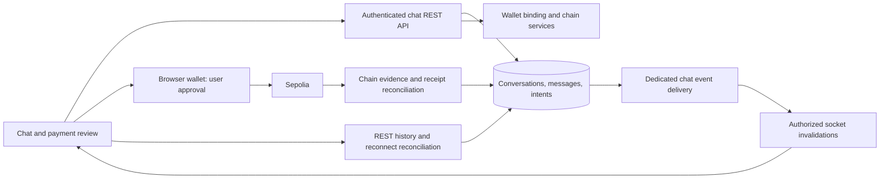

# Peer chat and crypto sharing — design draft

Status: Design target with initial text-chat implementation, 29 October 2026. The implementation status below distinguishes saved source from verified delivery. Crypto payment/receipt sections remain proposed.

## Current implementation

The initial implementation adds `ChatController`/`ChatService`, shared contracts and a Chat destination with exact-handle conversations, plain text, stable-ID retries, ordered history, unread counts, private read cursors and bidirectional blocking. Chat is independent of wallet existence. Message/sequence/event writes commit together; `chatEvents` remains retained for future transport, separate from the demo outbox. Additive collections initialize at API startup; existing users need no wallet backfill. See [service source](../apps/api/src/modules/chat/chat.service.ts), [screen](../apps/web/src/ChatPanel.tsx), [unit cases](../tests/unit/chat.test.mts) and [executable scenarios](../tests/features/chat.feature).

This first slice refreshes the active visible thread and inbox every five seconds and on focus, using bounded REST gap recovery; no socket worker is implemented. Read state changes through an explicit **Mark conversation as read** action. Text and ambiguous-send identities stay in memory per conversation and clear on sign-out; reload relies on persisted server history. Browser failures with uncertain delivery retain the same ID/body for retry. The conversation list is paginated; the initial release does not send messages while disconnected or expose online/read presence. Crypto sending/receive cards and shared receipts remain C3/C4 work.

Production build, lint and test type checks passed. Fifteen focused chat/wallet-switch/navigation unit cases passed with JUnit XML. Database Cucumber and live browser checks remain blocked by sandbox localhost networking; no deployed/live delivery is claimed. The API/browser scenario source includes duplicates, privacy/CSRF, blocks, walletless users, restart, a 55-message gap and two real browser sessions; the browser case has not run. See [handover](../onboarding.md) for exact commands and limits.

## 1. Goal and scope

Let two registered Offgrid users talk, share a verified receive address and send crypto from the conversation, with a receipt that both participants can inspect. Chat must remain useful without a wallet, and receiving a payment must not require the recipient to be signed in or have the conversation open.

The first release follows the existing [high-level architecture](HIGH_LEVEL_DESIGN.md): **peer-to-peer means a conversation between users, coordinated by the application server**. It requires connectivity for message delivery. Offgrid is the product name, not a promise of mesh networking or offline blockchain settlement. Bluetooth, local mesh, WebRTC transport and end-to-end encryption need separate transport/key-management designs.

| Include in the first release                                                                         | Keep outside this release                                                                               |
| ---------------------------------------------------------------------------------------------------- | ------------------------------------------------------------------------------------------------------- |
| One-to-one text conversations, exact-handle discovery, history, unread counts and reconnect recovery | Groups, attachments, voice/video, typing indicators, public presence and read receipts                  |
| Share a receive address from the user's verified wallet binding into one conversation                | Public wallet directories, automatic disclosure of all peer addresses, pasted-address payment shortcuts |
| Send Sepolia ETH or a supported standard ERC-20 token through the existing browser wallet            | Mainnet, custody of private keys, swaps, escrow, bridges, smart-account/batched payments                |
| A participant-visible payment card with transaction evidence and confirmation state                  | Payment requests, fiat conversion, automatic recurring payments, receipt forwarding to strangers        |
| Blocking, bounded message rates and accessible mobile/desktop layouts                                | Message editing/deletion, disappearing messages and background offline sending                          |

Sepolia assets must carry a **Testnet** label. Existing simulated balances remain separate; a demo-unit transfer must never be presented as a crypto transfer. Legacy demo sending stays in its current Wallet/Send flow for this first release. Guarded local chain 31337 is a fixture path for automated verification, not another public product network.

## 2. Verified starting point

Source inspected on branch `work`, baseline commit `b62bdac`; the working tree was clean before this design. Source availability is not evidence of delivery on the user's browser URL.

| Existing boundary                                                                                                                                                                                                                  | Reuse and required addition                                                                                                                                                         |
| ---------------------------------------------------------------------------------------------------------------------------------------------------------------------------------------------------------------------------------- | ----------------------------------------------------------------------------------------------------------------------------------------------------------------------------------- |
| [ChatModule](../apps/api/src/modules/chat/chat.module.ts) is empty, though imported by the API                                                                                                                                     | Add conversation persistence, membership enforcement, REST endpoints and a delivery transport. No existing chat behavior to migrate.                                                |
| [Workspace navigation](../apps/web/src/consumer-navigation.ts) and [UserWorkspace](../apps/web/src/UserWorkspace.tsx) have no chat destination                                                                                     | Add `#/chat` and `#/chat/:conversationId`, keeping current hash navigation and account-switch cleanup.                                                                              |
| [IdentityEligibility](../apps/api/src/modules/auth/identity-eligibility.service.ts) resolves minimal public peer profiles                                                                                                          | Reuse exact-handle identity lookup independently of wallet ownership; never expose email or sessions.                                                                               |
| [WalletsService.resolve](../apps/api/src/modules/wallets/wallets.service.ts) resolves **simulated** recipients                                                                                                                     | Do not reuse that result as an EVM destination. Add the conversation-scoped receive-address and payment-intent contracts below.                                                     |
| [External wallet ownership](../apps/api/src/modules/wallets/external-wallet.service.ts) binds a proved address to a user wallet/network and tracks revisions                                                                       | Share only a binding selected by its owner. Current implementation allows one address per wallet/network and does not support address replacement.                                  |
| [Testnet wallet](TESTNET_WALLET.md), [TestnetBalance](../apps/web/src/TestnetBalance.tsx), [ChainAssetsPanel](../apps/web/src/ChainAssetsPanel.tsx) and client helpers implement wallet-approved native/ERC-20 sends               | Reuse signing, exact quantities and unknown-outcome safeguards. [WalletPanel](../apps/web/src/WalletPanel.tsx) handles simulated assets; it is not the crypto sender.               |
| [ChainWalletService](../apps/api/src/modules/chain-wallet/chain-wallet.service.ts) registers hashes and indexes owner-scoped activity                                                                                              | Add exact payment-intent matching and a limited shared receipt projection. Registration currently proves the linked sender, not that a hash paid the chat peer the reviewed amount. |
| [OutboxService](../apps/api/src/workers/outbox.service.ts) accepts only `transfer.updated`; [OperationsService](../apps/api/src/modules/operations/operations.service.ts) claims eligible outbox rows without an event-type filter | Isolate chat delivery as described below. Adding chat events directly would expose them to a consumer that assumes demo-transfer payloads.                                          |

The legacy [chain module](../apps/api/src/modules/chain/chain.service.ts) is the simulated transfer audit chain. Public-chain payment evidence belongs to `chain-wallet`, not that module. Existing [worker lifecycle](WORKERS.md), [authentication](AUTHENTICATION.md) and [testnet ownership/receipt rules](TESTNET_WALLET.md) remain authoritative.

## 3. Screens and interaction design

Keep the existing warm off-white surfaces, dark green text/actions, restrained borders and typography in [styles.css](../apps/web/src/styles.css). Add **Chat** between Activity and Settings. The design extends the application rather than replacing its visual system.

Desktop uses a roughly 280px conversation list beside a flexible thread. Narrow screens show the list or one thread, with a visible Back action. The payment review is a side panel on desktop and a full-height sheet on mobile; it must not obscure the wallet confirmation step.

```text
Home  Wallet  Send  Activity  Chat  Settings
┌──────────────────────┬──────────────────────────────────────────────┐
│ Chat      [New chat] │ Bob · @demo_bob                    [Options] │
│ Find a conversation  │ Chat connection: Connected                  │
│                      ├──────────────────────────────────────────────┤
│ Bob              2   │ Bob: Here's my testnet receive address.      │
│ Alice                │ ┌ Receive crypto · Ethereum Sepolia ──────┐ │
│                      │ │ Shared by Bob · ownership verified       │ │
│                      │ │ 0x12…89ab       [View full address]      │ │
│                      │ └─────────────────────────────────────────┘ │
│                      │ You: Sending the test tokens now.            │
│                      │ ┌ You sent 5 OGT · Testnet ────────────────┐ │
│                      │ │ Confirming · 3 of 12 blocks              │ │
│                      │ │ [View transaction]                      │ │
│                      │ └─────────────────────────────────────────┘ │
│                      ├──────────────────────────────────────────────┤
│                      │ [Write a message…]                   [Send] │
│                      │ [Send crypto]       [Share receive address] │
└──────────────────────┴──────────────────────────────────────────────┘
```

This is a wireframe with illustrative data, not a screenshot or proof of a transfer. Connection status describes the **current client's connection to Offgrid**, not the peer's availability.

### Start and use a conversation

1. **New chat** accepts an exact public handle. Show display name and handle before opening; do not offer a browsable user directory. Unknown, disabled, blocked and self targets receive a generic unavailable result.
2. Opening a pair returns its existing conversation or creates one. Creating a conversation without a message does not notify or add an empty item to the recipient's list.
3. Send plain text with a stable client message ID. Show **Sending**, then **Sent** only after server persistence. A lost response shows **Checking delivery** until the same ID is reconciled. Neither a successful HTTP response nor a socket broadcast proves the recipient read it.
4. The recipient gets unread counts. Opening a visible thread advances their private read cursor; it does not expose a read receipt to the sender. Do not mark hidden tabs, off-screen history or unread messages below the viewport as read.
5. If disconnected, keep the composer draft in memory and explain **Reconnect to send**. Do not enqueue automatic sends. A definitive rejection offers Edit/Retry; an ambiguous send retries only its original ID and body. Clear private text on sign-out/account change; no persistent browser history cache in this release.
6. Options includes **Block peer**. Blocking prevents new messages, receive-address sharing and new payment admission in either direction; it retains history and already-admitted payment reconciliation. It cannot prevent a person from sending on-chain to an address they already know. Unblocking never replays blocked sends.

### Share a receive address

From the thread, the recipient chooses **Share receive address**, selects their own verified Sepolia binding and reviews the full address/network. Explain that sharing makes this public blockchain address and its link to the user's handle visible to this conversation's other participant. Require an explicit share action; do not expose bindings merely because somebody opens a conversation.

The server creates a structured receive-address message from the owner's binding, not client-supplied address text. Store the binding ID, revision, network identity, address and verification time as a snapshot. The card says **Ownership verified when shared**; it does not claim identity vetting or a guarantee that the owner still controls a key. Current eligibility is checked again before every payment. Revoked/reverified bindings make the old card unavailable for new sends until the owner shares a current card. History preserves the address actually shared.

If the peer has not shared an eligible destination, **Send crypto** explains **Ask this peer to share a verified receive address**. Chat remains usable. Plain-text addresses and links are never automatically promoted into trusted payment actions.

### Send crypto from the thread

1. **Choose:** keep the conversation peer fixed; select their eligible receive-address card, the sender's verified binding, native ETH or an imported standard token, and a positive decimal-string amount. Show network, contract address for tokens, exact balance and testnet label. A lookup/RPC failure is **Balance unavailable**, never zero.
2. **Review:** show peer handle, full destination, source address, network/chain ID, asset identity, amount, and ownership verification time. Gas is paid in ETH. The browser wallet supplies the final fee estimate and total; do not invent a zero fee or subtract token fees from token quantity. Cancel/Back preserves editable entries without spending.
3. **Confirm in wallet:** fresh server authorization freezes the reviewed intent, then the client writes the durable submission marker before invoking the existing wallet helper once. Recheck wallet account/network. The wallet alone signs and broadcasts. A definitive wallet rejection allows a new explicit review with a new intent; an uncertain response requires recovery, never another automatic signing call.
4. **Share outcome:** persist the returned hash locally and attach it to that intent. The server verifies chain evidence before emitting a payment card. If recording fails, say **Submitted; receipt sharing pending** and retry only attachment of the same hash. Chat failure cannot roll back a blockchain payment.
5. **Track:** a card shows amount, asset, Testnet, sender/recipient, hash, current chain state, confirmation count and last check. Details expose full addresses and token contract. Provider failure shows the last known state with **Updates unavailable**. The peer's login/read state does not affect settlement.

Use separate delivery and money states:

| Track                 | States and meaning                                                                                                        |
| --------------------- | ------------------------------------------------------------------------------------------------------------------------- |
| Text message          | Local draft → Sending → Sent; Checking delivery for ambiguity; Not sent only on definitive failure                        |
| Payment authorization | Review → Authorized for one wallet attempt; expired/cancelled review cannot authorize; signing ambiguity stays unresolved |
| Hash observation      | Hash retained locally / attachment pending → provider-verified submission; absence from one provider is not failure       |
| Chain receipt         | `PENDING` → `MINED` → `CONFIRMED` (12 blocks); `REVERTED` or `REORGED` where supported by observed evidence               |
| Chat card publication | Pending → Published; independent of chain state and retried without signing                                               |

`CONFIRMED` is the existing 12-block product policy, not irreversible finality. Reorgs can change a previously confirmed card. A reverted token call does not mean tokens were sent. Automatic adoption of wallet replacement/cancellation transactions is deferred. Show **Check wallet activity** with the original hash; do not mark a cancellation as paid or infer a replacement from elapsed time. A future replacement-link contract must match sender and nonce and verify the intended transfer again.

Accessibility: label all controls, support keyboard send without interfering with IME composition, use Shift+Enter for a newline, restore focus when closing sheets, and announce new messages/status changes politely without rereading history. Provide a new-message indicator when scrolled up instead of forcing a jump. Use text plus icons, not color alone. Validate at 360px width and 200% zoom; full addresses must wrap and remain copyable.

## 4. Architecture and consistency



There is no database transaction spanning chat and Sepolia. The durable payment intent connects an authorized user action to separately observed chain evidence. MongoDB never debits/credits crypto. Chat code must not write simulated balances, ledger entries or custody lots.

### Persistence and concurrency

Proposed collections use the existing MongoDB replica set and strict validators. IDs are ObjectIds except UUID client keys/event IDs; API sequences/base units/revisions are decimal strings. Version every new record/contract.

| Collection            | Main fields and constraints                                                                                                                                                                                                                                                                                                                        |
| --------------------- | -------------------------------------------------------------------------------------------------------------------------------------------------------------------------------------------------------------------------------------------------------------------------------------------------------------------------------------------------- |
| `conversations`       | Immutable sorted two-user `participantIds`, unique `canonicalPairKey`, `lastSequence` (64-bit), last-message metadata, timestamps. Pair creation uses unique-upsert recovery; reciprocal requests produce one conversation. No participant replacement or groups.                                                                                  |
| `conversationMembers` | `conversationId`, `userId`, `readThroughSequence`, `lastMessageAt`, unread count. Unique `(conversationId,userId)` and `(userId,lastMessageAt desc,conversationId desc)` inbox index. Rows created with the conversation.                                                                                                                          |
| `messages`            | Conversation, monotonic sequence, author, `clientMessageId`, canonical payload digest, kind `TEXT / RECEIVE_ADDRESS / CRYPTO_TRANSFER`, typed content/reference, time. Unique `(conversationId,sequence)` and `(conversationId,authorId,clientMessageId)`. Payment cards also unique by `paymentIntentId`.                                         |
| `chatBlocks`          | `ownerId`, `blockedUserId`, state/revision. Unique directed pair; durable pair eligibility revision/fence coordinates blocking and admission.                                                                                                                                                                                                      |
| `chatPaymentIntents`  | Conversation/sender/recipient, client key/digest, receive-message ID, immutable binding/network/asset/address/quantity snapshots, review expiry, authorization attempt ID/state, hashes/evidence references, publication state. Unique `(senderId,clientIntentId)`. At most one signing authorization per intent; retain its outcome and evidence. |
| `chatEvents`          | Stable event ID, conversation, event type/reference, event revision, attempts, next-attempt time, lease token/expiry and publication time. Unique event ID; due-event index. Contains references, not message bodies or keys.                                                                                                                      |

Create the message, allocate its next sequence, update inbox/unread state, and persist its chat event in one snapshot/majority transaction. Concurrent sends contend on the conversation counter and retry safely. A duplicate client key with the same canonical body returns the original message; changed content returns `409 IDEMPOTENCY_CONFLICT`. Unknown commit outcomes reconcile that identity. An event is published only after commit.

Unread state counts incoming messages once. Advance the caller's read cursor monotonically up to the highest message actually presented to them, capped by server sequence; update unread state in the same transaction/fence as concurrent appends. Socket duplicates and receipt revisions must not inflate unread counts. Card status revisions update the existing card, not append another payment message.

Chat creation, sends, blocking and payment admission must coordinate on the same conversation/eligibility records. A check followed by an unrelated write is insufficient to enforce a concurrent block/suspension. Reuse transaction-aware identity checks and add the chat pair fence. Block linearizes against admission; already-admitted records stay readable/reconcilable.

Never TTL-delete message IDs, admitted payment identities or shared receipts in this release. Expiry invalidates an unsubmitted review but cannot erase an uncertain signing attempt. Retention/deletion policies need a later explicit decision; avoid logging bodies, amounts, private notes or wallet secrets.

### Delivery, reconnect and session security

REST is the authoritative write/history path. Socket.IO initially carries invalidations (`chat.message.created`, `chat.payment.updated`) with IDs/sequences/revisions, not a second message-send API. This is a refinement of the parent HLD's proposed socket actions: one HTTP mutation path reduces divergent CSRF/idempotency rules.

Use a dedicated `chatEvents` collection/leased worker so chat never competes with the existing demo notification consumer or inherits its historical activation boundary. Retain all existing `outboxEvents` and their delivery semantics. Independently add an explicit `eventType: 'transfer.updated'` selector to the existing consumer before any future shared-outbox expansion; cover it with regression tests. Update [WORKERS.md](WORKERS.md) when these workers are implemented.

The chat worker uses bounded batches, expiring claims and claim-token-fenced acknowledgements. At-least-once broadcasts are expected. A successful emit means only **published to the transport**; it never sets a message to delivered/read by a peer. Disconnect/restart after publish may duplicate events. History remains authoritative if the gateway is down.

Authenticate sockets with the existing session cookie and an exact Origin allowlist; do not put tokens in query strings. [AuthGuard](../apps/api/src/modules/auth/auth.guard.ts) is HTTP-only, so a gateway adapter is required. Authorize every subscription and revalidate the session before each outbound invalidation and inbound action, including on quiet connections at a bounded interval. Revoked/expired/disabled identities must receive no subsequent private events. Client-supplied room/user IDs never confer access. Require TLS in deployment; message text remains server-readable and must never be described as end-to-end encrypted.

Reconnect sequence: authenticate → authorize/subscribe → fetch messages after the last contiguous sequence → merge buffered invalidations → fetch remaining gaps. Deduplicate by message ID/sequence and payment revision. Paginate until caught up; fetch card updates by event or refresh receipt projections on reconnect because old cards may have changed without a new message sequence. A 15-second visible-thread fallback refresh with backoff covers lost notifications; pause hidden tabs and refresh on focus. Recheck authorization on every read. Multi-instance gateways require a shared fan-out adapter before enabling multiple serving replicas; the first release uses one gateway process.

## 5. Proposed HTTP contracts

All paths below are **new**, under `/api/v2/chat`. Authenticated reads use `Cache-Control: no-store`; writes require the current Origin/CSRF checks. Strictly reject unknown fields. Derive caller/sender IDs from the session. Membership is mandatory for each resource; foreign/nonexistent resources share `404 UNAVAILABLE` behavior.

| Method and path                                          | Input → behavior                                                                                                                                                                                                                                                                                      |
| -------------------------------------------------------- | ----------------------------------------------------------------------------------------------------------------------------------------------------------------------------------------------------------------------------------------------------------------------------------------------------- |
| `POST /conversations`                                    | `{peerHandle}` → create/return canonical pair; exact handle, active peer, no self/block; independent of wallets.                                                                                                                                                                                      |
| `GET /conversations?cursor=…`                            | Participant inbox, 20 default/50 maximum, opaque scoped cursor over activity time + ID. Empty peer-side conversations excluded.                                                                                                                                                                       |
| `GET /conversations/:id/messages?before=…` or `?after=…` | At most 50 messages with sequence cursors; directions mutually exclusive. Include latest receipt projections, next cursor and high-water sequence.                                                                                                                                                    |
| `POST /conversations/:id/messages`                       | `{clientMessageId,text}` → persist text+event atomically; UUID key and payload-digest replay rules.                                                                                                                                                                                                   |
| `POST /conversations/:id/read`                           | `{throughSequence}` → monotonic private read/unread update; no public read receipt.                                                                                                                                                                                                                   |
| `POST /conversations/:id/block`                          | `{blocked:boolean}` → update caller-owned block and pair eligibility atomically; cannot unblock the peer's block.                                                                                                                                                                                     |
| `POST /conversations/:id/receive-addresses`              | `{clientMessageId,bindingId,revision}` → owner-selected verified address message; server derives all address/network fields.                                                                                                                                                                          |
| `POST /conversations/:id/payment-intents`                | `{clientIntentId,receiveMessageId,senderBindingId,asset,quantity}` → immutable review snapshot and expiry. `asset` is `{kind:'NATIVE'}` or `{kind:'ERC20',contractAddress}`; symbol is never identity.                                                                                                |
| `POST /payment-intents/:id/authorize`                    | `{attemptId}` → recheck participants/block, receive-card and binding revisions, supported active network, asset metadata/balance and review expiry; atomically admit exactly one attempt, return frozen transaction plan. Duplicate attempt returns the same admission, not permission to sign twice. |
| `POST /payment-intents/:id/transactions`                 | `{hash}` → original sender attaches same-chain evidence to an admitted intent; verify exact tuple before linking. Repeated hash is idempotent. New unmatched/replacement hash requires explicit reconciliation, not another spend.                                                                    |
| `GET /payment-intents/:id`                               | Participant receipt projection; before verified submission only the sender sees private review/attempt details. Recipient receives a card only once submission is verified.                                                                                                                           |

Each intent permits at most one wallet attempt. `POST /payment-intents/:id/cancel {revision}` conditionally changes an unadmitted `REVIEW` to `CANCELLED`; repeated cancellation is idempotent and conflicts if authorization already won. Review expiry and cancellation never cancel an admitted attempt or a chain transaction.

`POST /payment-intents/:id/attempt-outcome {attemptId,revision,outcome:"WALLET_REJECTED",providerCode:4001}` records a client-observed EIP-1193 rejection for the original sender and exact attempt, using conditional revision checks. It cannot overwrite a recorded hash or verified chain evidence. This is a client report, not proof of nonpayment; retain the attempt and accept later matching evidence. A new, explicit user review after this conclusive wallet response creates a new intent/clientIntentId. Never reauthorize or silently reuse the original intent.

Any timeout, disconnect, malformed response, unknown provider error, reload without conclusive evidence or conflicting hash leaves the attempt `UNRESOLVED`. Unresolved admission blocks the chat coordinator from opening another signing attempt for that sender binding until evidence is reconciled or the explicit recovery hold is released below; reconciling a known hash does not sign. Persist the attempt marker before the wallet RPC and coordinate tabs (e.g. Web Locks plus owner-scoped durable markers). Another device seeing an admitted attempt offers reconciliation, not signing. Centralize this submission coordinator across Chat, TestnetBalance and ChainAssetsPanel; their current component-local locks and separate storage keys cannot protect a new independent chat sender. Server idempotency cannot make an external wallet call exactly once; browser rejection reports and external wallet behavior remain explicit trust boundaries.

For a no-hash interruption, **Review wallet activity** first offers recovery by attaching the original hash. If the user cannot establish an outcome (including a crash between admission and opening the wallet), a separate **Release recovery hold** action explains: **The previous payment may still complete. A new payment could pay twice.** Proposed `POST /payment-intents/:id/recovery-release {attemptId,revision,acknowledgeUnknownOutcome:true}` records a user-directed release with revision checks; it does not mark the payment failed/cancelled, remove its evidence, or spend anything. The original intent remains unresolved and reconcilable. Only a new explicit review/intent may follow. No timer, reconnect, missing RPC result or background worker may perform this release. The UI must retain both intents if evidence later arrives. This escape is a user decision under uncertainty, not an exactly-once guarantee.

Suggested errors distinguish `REVIEW_REQUIRED`, `BINDING_UNAVAILABLE`, `NETWORK_UNAVAILABLE`, `INVALID_QUANTITY`, `INSUFFICIENT_BALANCE`, `IDEMPOTENCY_CONFLICT`, `ATTEMPT_UNRESOLVED`, `TRANSACTION_MISMATCH`, `EVIDENCE_PENDING`, and `RATE_LIMITED`; map them to retained inputs and clear next actions. RPC errors never cause new hashes, new signing attempts, or confirmed cards. Missing auth returns 401 and triggers existing sign-out cleanup.

Initial bounded defaults: 1–4,000 Unicode code points and at most 16 KiB UTF-8 per text; reject whitespace-only text and unpaired surrogates; 30 sends/minute per user, 60 conversation opens/hour, 10 payment reviews/minute, and 5 sockets/user. Use shared durable rate counters, not per-process limits, return `Retry-After`, and exercise byte/character boundaries. Render text and token metadata as text; links cannot execute scripts or silently launch a transaction. No attachments/HTML/Markdown execution.

### Payment evidence and privacy contracts

The sender and recipient must be the conversation participants. A receive card can only name its author's binding; a sender cannot create a verified card on behalf of the peer. The payment-intent service derives the destination from that card and a current binding check, never from a message body or a URL parameter. Initial reviews expire after five minutes by server time; expiry never erases admitted attempts.

Before admission, freeze `networkId`, chain ID plus configured chain identity/revision, sender and recipient binding IDs/revisions, normalized addresses, asset kind/contract, validated decimals/code identity, exact base units and expected transaction calldata/value. Native quantities use the existing ETH parser; token amounts use existing bigint/ABI rules. Do not copy the legacy signed-64-bit demo balance limit onto EVM uint256 amounts. Revalidate mutable rules at authorization and show fresh review on changes. No server preflight can stop a previously authorized wallet popup from later signing; after that boundary, reconcile what actually happened.

Reuse `GET /api/v2/wallet/bindings/:id/balance`, chain token reads/preparation and existing client signing helpers. Native transaction-plan creation needs a shared server validation path for chat review; ERC-20 preparation currently exists at `/api/v2/wallet/bindings/:id/chain/prepare`. Neither preparation nor authorization broadcasts anything.

For native payment evidence require the expected chain, sender, destination, exact value and allowed empty calldata. For ERC-20 require the expected sender, token contract, zero native value and decoded standard `transfer(recipient,units)` call; mark paid only after a successful canonical receipt and a matching Transfer event. A generic `CONTRACT` activity row or receipt status alone is not proof of a token transfer. A missing, mismatched or ambiguous transfer event shows **Payment not verified**. Existing token import checks do not prove standard transfer semantics: a malicious token can emit a matching event without the expected balance effect, and rebasing/fee behavior is not universally detectable from receipts. Describe token completion as **Confirmed transfer event**; token semantics and provider trust remain explicit boundaries. Do not claim an independently verified recipient balance increase or guaranteed economic value.

For this single-transfer release, atomically reserve a unique `(networkId,transactionHash)` claim for one intent after its transaction tuple matches; retain the claim through reorgs, rejection reports and receipt failures. Keep the matched event as versioned evidence: native uses a `native` discriminator; ERC-20 retains the observed log index plus block hash. A log index can change when the same transaction is re-mined, so it must not release the transaction claim or create another payment card. The existing public `ChainActivity` contract omits its internal event key; add the observation reference to the chat projection. A hash claim alone is not proof of payment: select exactly the matching transfer event and reject ambiguous matches. Never infer nonpayment from a missing history row: existing scans are bounded, start near subscription time, and include only imported tokens. The admitted-intent reconciler must retrieve the specified hash/receipt directly when it lies outside that scan window.

The existing registration route only verifies a linked sender and the existing history route is owner-only. Do not broaden those routes to expose a wallet's full history to chat peers. Add a bounded projection containing only this intent's participant IDs, disclosed addresses, asset/amount, hash, confirmation/evidence status and last-check metadata. Do not expose other balances, transfers, bindings, email, signature challenges or session data. No public receipt URL is introduced. Explorer links must use a configured network base URL and validated hash.

Freeze the authorization block number/hash and a sender nonce observation with the review evidence. Reject an already-mined transaction at or before the authorization checkpoint as a new chat payment; do not allow historical matching amounts to masquerade as a fresh send. Pending visibility and wallet signing time cannot be established perfectly from RPC: the card proves a matching observed transaction, not cryptographic causation by the chat action. Display its actual mined time/block, not the message creation time as the payment time. An explicit share-existing-receipt flow remains deferred.

Receipt synchronization must survive later binding revocation, network pauses and chat blocking: preserve the original immutable intent and last-known outcome, mark freshness accurately, and resume evidence checks only through allowed network policy. Existing owner-binding synchronization alone cannot provide this because it requires an active binding. Add an admitted-intent reconciler using the original authorized snapshot and bounded public chain reads; it grants no new signing permission. A returning authenticated original sender may attach evidence to their already-admitted intent after binding revocation, with exact transaction matching; this does not authorize new sends. Unauthenticated attachment remains forbidden.

The admitted-intent reconciler needs a persisted per-intent lease/token plus conditional revision checks, bounded batches and drain-on-shutdown lifecycle. Fetch chain evidence outside database transactions; before committing, recheck the claim, allowed network revision and canonical checkpoint. Commit the evidence projection, increasing `receiptRevision`, payment-card insertion/update and `chatEvents` row atomically. A stale worker must fail its conditional write rather than overwrite newer confirmed/reorg evidence. Clients ignore older receipt revisions; failed RPC checks preserve previous evidence and separately update freshness/error state.

Keep only owner-scoped public identifiers/hash and unresolved-attempt markers in browser persistence; never store keys, signatures, chat text or unsubmitted payment notes there. On logout clear rendered/private state, close sockets, abort outstanding requests and hide stored markers from other accounts. Preserve ambiguous attempt evidence for the same user after reauthentication. If durable marker storage is unavailable, stop before requesting a wallet transaction.

## 6. Acceptance scenarios planned before coding

These are design acceptance cases, **not executed tests**. Implementation must add TypeScript unit suites producing JUnit XML plus executable Cucumber `.feature` scenarios/step definitions with happy, negative and edge cases. Suggested tags: `@chat`, `@chat_crypto`, `@chat_browser`; use isolated synthetic users/databases and local Ganache/provider fixtures.

| Area            | Happy flow                                                                  | Negative flow                                                                                       | Edge/recovery flow                                                                                                                                          |
| --------------- | --------------------------------------------------------------------------- | --------------------------------------------------------------------------------------------------- | ----------------------------------------------------------------------------------------------------------------------------------------------------------- |
| Conversation    | Exact handle opens one pair; walletless peer can chat                       | Unknown/self/disabled peer; nonmember list/read/write/subscribe denied                              | Reciprocal concurrent opens and changed display name retain one pair                                                                                        |
| Text/history    | Persist before acknowledgement; ordered pages and unread counts             | Empty/oversize/invalid-Unicode text, script content, CSRF and rate limits                           | Duplicate key returns one row; changed body conflicts; lost response/commit and worker restart                                                              |
| Delivery        | Socket event fetches persisted messages                                     | Expired/revoked session receives no further event; forged room denied                               | Subscribe/history race, out-of-order duplicates, >50 missed messages, gap recovery and lost card revisions                                                  |
| Block/read      | Private read cursor and bidirectional chat block                            | Blocked admission; caller cannot undo peer block                                                    | Concurrent block/send and read/append; old receipt still reconciles; unread never negative                                                                  |
| Receive address | Owner explicitly shares verified testnet binding                            | Stranger binding, pasted address, other chain, revoked binding                                      | Reverification invalidates old card; peer logged out remains a valid recipient                                                                              |
| Crypto review   | Exact ETH/ERC-20 amount, fixed peer, testnet/network/contract shown         | Zero/overprecision/overflow/insufficient balance, stale review, paused network, wrong account/chain | Binding/block revision changes between review and authorization; changing gas/balance                                                                       |
| Submission      | One wallet confirmation then same-hash attachment                           | Definitive rejection, storage unavailable, unrelated hash/recipient/token/amount                    | Double click, two tabs/devices, reload before/after RPC, lost hash response, API failure after broadcast, explicit recovery release; never automatic resend |
| Receipts        | Both participants see correct submitted/mined/12-block confirmation         | Provider absence is pending; a token contract call alone is not paid; nonparticipant access denied  | Revert, duplicate logs, re-mined log index, stale worker, historical-hash replay, replacement ambiguity, revoked binding and stale RPC                      |
| Regression/UI   | Existing Wallet/Send/Activity flows stay usable; mobile/keyboard navigation | No demo-transfer notification consumer claims chat data; no mainnet enabled                         | Back/reload/deep links, IME, 200% zoom, account-switch cleanup, no chat text in local storage/logs                                                          |

Test receipt verification with a real local EVM and actual native/ERC-20 balances; mocked response shape tests alone cannot prove money movement. Retain existing wallet, authentication, notifications, workers and navigation regressions. Inspect nonempty JUnit reports for failures/errors/skips and Cucumber reports for pending/undefined steps. For delivery, separately verify the exact intended URL (previously `http://localhost:5173`, re-establish before implementation), frontend → API → database, and disposable wallet → local EVM → receipt. Record served version, time, synthetic identities, actions, expected/actual outcomes and screenshot/report paths. Public Sepolia acceptance remains separate and requires an authorized test wallet/faucet ETH; never real funds or private keys in chat.

## 7. Delivery stages and decisions

| Stage                             | Concrete result and exit condition                                                                                                                                                                                |
| --------------------------------- | ----------------------------------------------------------------------------------------------------------------------------------------------------------------------------------------------------------------- |
| C1 — Conversation foundation      | Contracts, validators/indexes, wallet-independent peer lookup, participant/block checks, stable-ID text writes, ordered history, private unread state; unit and executable API scenarios pass.                    |
| C2 — Chat experience and recovery | Chat routes/screens, dedicated event worker, authorized gateway, reconnect/fallback refresh, accessible empty/error/mobile states; real browser/API/database scenarios pass.                                      |
| C3 — Crypto admission             | Owner-shared receive cards, immutable reviews, shared native/ERC-20 plan validation, one-attempt authorization and durable client recovery; signing/negative/concurrency tests pass.                              |
| C4 — Shared receipts              | Exact intent-to-chain verification, participant projection, admitted-intent reconciliation, reorg/failure states and publication retries; real local EVM/browser scenarios and exact-service delivery check pass. |

Expose each stage only when its own end-to-end path works; do not place a live-looking Send crypto control in a released chat screen before C3/C4 are ready. Additive chat collections need explicit schema/index initialization, but no simulated-wallet migration, issuance or seed of existing users. Preserve all existing financial data. Existing users can chat without re-registering; crypto requires their own verified binding and the peer's deliberate address share.

Working decisions for this draft: server-mediated one-to-one chat; REST writes plus socket invalidations; explicit receive-address sharing; Sepolia-only noncustodial sending; separate chat events; no offline autosend or read receipts. These decisions follow existing architecture and can be revised before implementation. The next work item is C1 with its tests; the current source implements the initial text-chat slice; completing database/browser acceptance and then C3/C4 remains outstanding.

## 8. Design review and evidence

This draft was checked against the source boundaries linked above. A bounded read-only subagent review examined the existing wallet clients, peer resolution and chain APIs; the primary agent integrated the findings, including the simulated/crypto separation and the need for a new recipient-scoped contract. This is source/design review, not an independent implementation or security certification. Document validation and handover results are recorded in [onboarding.md](../onboarding.md).
