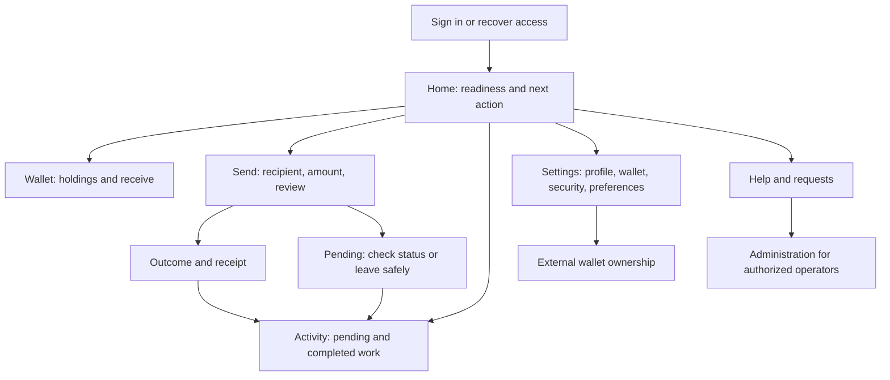

# Consumer ownership and website experience plan

Design snapshot: 26 October 2026. Companion to the [business/API HLD](BUSINESS_API_ENHANCEMENT_HLD.md) and [delivery plan](ENHANCEMENT_DELIVERY_PLAN.md). Core P00–P08 implementation is authorized; [actual contracts and delivery gates](DEMO_ENHANCEMENTS.md) record the implemented scope separately from this target experience. Consumer journeys include failure and safe exit paths.

## 1. Experience promise

**A user should always know where they are, what they can do next, what happened to their assets, and how to leave safely.** Configuration should be discoverable, understandable and available to the correct role without routine CLI work.

The current website already has focused task navigation, active-page indication, Back/Forward behavior and draft preservation while switching mounted panels. Preserve these improvements. This is a completion and simplification plan, not a reason to rebuild the frontend or change the settlement engine.

The live baseline and scope are recorded in the [HLD evidence section](BUSINESS_API_ENHANCEMENT_HLD.md#2-evidence-and-current-gaps). Ordinary-user screens were inspected on the actual service; current administrator mutation flows and external signing were not re-exercised in this session. Friction below is an architectural/usability assessment, not a claim from a user study.

## 2. Friction to remove

| Observed source/live behavior                                                                 | Consumer consequence                                            | Proposed change                                                                                                   |
| --------------------------------------------------------------------------------------------- | --------------------------------------------------------------- | ----------------------------------------------------------------------------------------------------------------- |
| Zero-balance wallet still leads directly into send                                            | The user has no actionable route to obtaining units             | Show a zero-balance explanation and Receive / Request demo allocation actions                                     |
| Assets offers Configure assets to an ordinary user; Administration leads to role instructions | User follows an action they cannot complete                     | Preserve discoverability; label Manage assets for authorized users and Request access / Get help for others       |
| Ordinary administration guidance includes `ADMIN_SETUP_TOKEN` and restart instructions        | Deployment work appears to be the consumer's responsibility     | Move bootstrap instructions to an operator installation view; show ordinary users request status and return links |
| Activity is below send and focuses on lot IDs, hashes and allocations                         | Receipts and next actions are hard to find                      | Separate Activity; plain receipt first; technical evidence in an expandable section                               |
| Auth/catalogue failures sometimes ask for a whole-page refresh                                | Refresh can discard unsaved work                                | Inline retry of the failed resource, retained fields and navigation available                                     |
| Wallet setup completion does not imply available balance or crypto sending                    | User may infer they are ready to send                           | Separate readiness: application wallet, supported asset, available balance, recipient, optional external link     |
| One unresolved intent replaces the send form; private intent is cleared on sign-out           | The user needs a safe way to leave and rediscover the outcome   | Pending banner, Activity inbox and server lookup after sign-in; do not pretend leaving cancels it                 |
| App keys wallet/setup panels by workspace revision after configuration changes                | Settings changes can remount another task's local draft         | Centralize identity-scoped draft ownership; invalidate stale reviews without losing editable input                |
| Admin subtab state is local; top-level bookmarks are supported                                | Reload/share cannot reliably open a specific configuration task | Add nested addressable destinations and retain legacy hash aliases                                                |

## 3. Navigation and information hierarchy

Recommended primary navigation: **Home, Wallet, Send, Activity, Settings**. Help is always available. Administration is a separate role-aware workspace with a visible access explanation for users who need it. On narrow screens use the same labels in a compact menu; do not make essential tasks gesture-only.

| Destination    | Primary content/action                                                         | Secondary content                                                                |
| -------------- | ------------------------------------------------------------------------------ | -------------------------------------------------------------------------------- |
| Home           | One next-best action based on readiness; unresolved transfers at the top       | Recent activity, help and environment label                                      |
| Wallet         | Per-asset available balances, Receive identity and Send entry                  | Assets catalogue; last refresh; optional external balances only when implemented |
| Send           | Recipient → asset/amount → review → result                                     | Save draft, Back/Edit, discard before submission, Help                           |
| Activity       | Pending, sent, received, rejected filters; search within authorized scope      | Transfer detail, receipt, optional chain/custody evidence                        |
| Settings       | Wallet preferences, profile display settings, security/sessions, notifications | External ownership link and accessible advanced settings                         |
| Administration | Assets, Networks, Policies, Requests, Demo data, Access, Audit, Operations     | Installation readiness restricted to operators                                   |

Use addressable destinations such as `#/home`, `#/send`, `#/activity/:id` and `#/admin/policies`; map existing `#wallet-title`, `#asset-catalogue-title`, `#wallet-setup-title`, `#administration-title` and `#admin-account-title` bookmarks compatibly. Exact routing implementation is a package decision; routing must not require a new hosting deployment. Browser Back returns to the prior task/filter, reload restores the destination, and an unknown location offers a safe Home fallback.

## 4. Journeys and exits

| Journey                           | Required happy path                                                                           | Negative/edge path and safe exit                                                                                                |
| --------------------------------- | --------------------------------------------------------------------------------------------- | ------------------------------------------------------------------------------------------------------------------------------- |
| First sign-in                     | Home explains demo mode; wallet already exists; optional setup can be skipped                 | Migration required shows service-owned issue and Help; do not suggest registering again                                         |
| Get started with zero balance     | Show own handle/wallet ID with copy controls and request demo units if supported              | No issuer configured: explain who can act and provide a configured support/request route; Wallet/Settings remain usable         |
| Send demo units                   | Enter recipient, show resolved identity, amount/limits, review, confirm once, receipt         | Unknown peer keeps fields; expired review returns to editable fields; insufficient balance explains Receive/request options     |
| Pending transfer                  | State “Still checking”; show original amount/recipient/reference, last check and Check status | Offer Return home and View activity; never a misleading Cancel or new-key Retry button                                          |
| Return after logout/device change | Server lists admitted pending work and previous outcomes                                      | No pending item does not prove an unknown local draft was sent; explain unsubmitted drafts separately                           |
| Link external wallet              | Explain ownership-only purpose; choose supported network; sign challenge; show verification   | Rejected signature/wrong network keeps route usable; cancel returns to Settings; no seed phrase entry                           |
| Change settings                   | Explain value/default/impact; validate; save; display effective revision/time                 | Stale revision shows current/saved values; keep unsaved input for comparison; Back with Save/Discard/Stay choices               |
| Recover account                   | Request reset, generic acknowledgement, one-use link, set password, sign in                   | Expired token offers a fresh request; delivery unavailable offers configured support; no email existence disclosure             |
| Request access/allocation         | Explain requested role/asset, submit once, show tracked request and result                    | Duplicate request links to existing; denial explains allowed next action; no self-grant or self-mint                            |
| Operator setup                    | Checklist: access → asset → activate → issue → verify demo transfer                           | Paused/failed setup is resumable; show exact prerequisite and owner; no hidden CLI prerequisite for supported business settings |

External wallet setup is optional for demo transfers. Do not force it into first-run onboarding. Do not place “available” beside planned payments/chat. Label demo/testnet/mainnet independently wherever an asset/network is displayed.

### Example recovery copy

| State               | Copy                                                                                                       | Actions                                                   |
| ------------------- | ---------------------------------------------------------------------------------------------------------- | --------------------------------------------------------- |
| Zero demo balance   | “You have no DEMO units yet. Receive units from a peer or request a demo allocation.”                      | Copy receive details; Request demo units if enabled; Home |
| Unresolved outcome  | “We are still checking this transfer. It may complete. You can leave this page and find it in Activity.”   | Check status; View activity; Home                         |
| Review expired      | “Your review expired. Your entries are saved. Review the recipient and amount again.”                      | Review again; Edit; Save draft                            |
| Permission missing  | “Asset management needs administrator access. You can request access or continue using your wallet.”       | Request access; Wallet                                    |
| Settings conflict   | “These settings changed while you were editing. Compare the latest values before saving.”                  | Compare; Reload latest; Keep editing                      |
| Service unavailable | “We cannot reach the service right now. Your draft is saved here. Submitted transfers may still complete.” | Retry connection; Home; Help                              |

Only claim a draft is saved when persistence succeeded. If storage is restricted, say “This draft is available while this page stays open” and never send without safely preserving the retry identity required by current client rules.

## 5. No trapped states: interaction contract

Every screen defines loading, empty, ready, validation failure, permission failure, service failure and session-expired behavior. Every blocked state supplies a reason, a concrete allowed next action and a safe exit. If the user cannot resolve the issue, identify the responsible role rather than repeatedly asking for refresh.

- Keep Home, navigation and sign-out usable during bounded work. Disable only actions that could duplicate or conflict with the same operation.
- Preserve editable recipient/amount when an asset list is empty or unavailable, as current regressions require; explain why Review is unavailable and provide an actionable alternative.
- Store drafts separately from admitted transfer intents. A draft may be discarded; an admitted intent stays in server Activity until its outcome is known. Browser storage is a convenience, not the source of financial truth.
- Initial draft durability: identity-scoped session storage survives reload; sign-out/account switch clears private browser state. Cross-device unsent drafts are outside the first release. Explain this before discard/sign-out when unsent work exists.
- On auth expiry, clear private content, provide sign-in and recover admitted work from the server. Do not retain another user's fields after an account switch or submit automatically after login.
- Settings changes update shared data without destructive task remounts. Changing asset/recipient/network invalidates review and requires fresh confirmation, while retaining safe editable values.
- Prefer inline errors next to fields and an error summary for multiple issues. Move focus to the relevant error; announce async results without repeatedly stealing focus.
- Notification dismissal and marking read never cancel work. Confirmation appears only for consequential operations, with exact impact and an equally clear escape.
- A completed transfer offers View receipt, Activity and Send again. Send again starts a fresh editable draft and always requires new review/confirmation.

## 6. Configuration experience

Create a **Settings overview** for consumers and a **Configuration overview** for administrators. Each lists supported settings, current state, permission and application timing. Search is bounded to visible sections; unavailable features show a reason, not a switch that cannot work.

Every form supplies a label, current/default value, units, accepted range, concise impact and field validation. Advanced controls stay behind progressive disclosure. Show locked identity fields with the reason and a “Create a new asset/network” route when appropriate. Do not expose a raw JSON editor as the primary UI.

Administrator publication follows the HLD: edit, validate, review change/impact, confirm reason, save, verify effective revision. Preview which unsubmitted reviews will be invalidated, whether observation continues, and whether a restart belongs to an installation task. Reverting a setting is a new audited change. Secrets use masked status and replace/test/revoke flows only after secure backend support exists.

Consumer choices include wallet name/default asset, locale/timezone, display preferences and supported notifications. They do not include permission escalation, editable balances or weakening security. Administrators receive the asset/network/policy/access/demo/operations controls in the [configuration ownership matrix](BUSINESS_API_ENHANCEMENT_HLD.md#6-ui-configuration-as-a-product-capability).

## 7. Accessibility and responsive acceptance

Target WCAG 2.2 AA for delivered journeys; this is an acceptance target, not a claim about current conformance. Verify keyboard operation, visible/unobscured focus, text contrast, labels, error identification, status announcements and target sizes against [WCAG 2.2](https://www.w3.org/TR/WCAG22/). Prefer comfortably sized controls beyond minimum requirements.

Test 360px and 390px mobile widths, desktop, 200% zoom and reflow at 320 CSS pixels. Long handles, addresses, error messages and identifiers must wrap or provide accessible copy/detail controls without hiding the primary action. Color must not be the only status signal. Include manual keyboard/screen-reader review; automated browser assertions alone do not establish conformance.

Keep environment, asset, exact amount and resolved recipient legible in review. Full destination identifiers remain inspectable. Relative times have an accessible absolute time/timezone. Format display locale independently of exact API decimal strings.

## 8. Product success criteria and rollout

Proposed targets to validate with synthetic tasks and a small usability study; no baseline conversion data currently exists:

| Measure                    | Acceptance target / method                                                                                                                                                                 |
| -------------------------- | ------------------------------------------------------------------------------------------------------------------------------------------------------------------------------------------ |
| Orientation                | From every delivered destination, Home and the current task are identifiable; no broken Back/deep-link path in scenario coverage                                                           |
| Recovery                   | Every tested pending transfer is discoverable after a new sign-in with browser storage cleared; original effect remains exactly once                                                       |
| Dead ends                  | Every modeled empty/error/permission state has a tested next action and safe exit                                                                                                          |
| Configuration completeness | Every supported business setting in the inventory has role-appropriate UI, validation, save/readback and persistence evidence; locked/deployment-only items explain ownership              |
| First-use comprehension    | At least 4 of 5 representative test participants can identify demo mode, explain how to receive units and find Activity without prompting; a small qualitative gate, not statistical proof |
| Task completion            | At least 4 of 5 can complete a funded demo send, find its receipt and change a default asset without help; record time/blockers before setting a time target                               |
| Safety                     | No accidental duplicate effect, unauthorized role change or lost admitted transfer in required negative/edge scenarios                                                                     |

Roll out in three consumer slices: (1) Home/readiness, safe exits, role-aware guidance and stable drafts; (2) server history, pending recovery and receipts; (3) configuration overview, requests, security and notifications. Backend dependencies determine package order in the delivery plan. Do not ship placeholder controls before their routes and persistence exist.

Instrument aggregate step entry/completion/failure and error codes only. Do not send amounts, addresses, handles, emails, tokens or free-text request reasons to product analytics. Choose retention and access before enabling telemetry. Recheck usability with ordinary, first-run, existing-user and administrator identities; an administrator-only happy path is insufficient.
