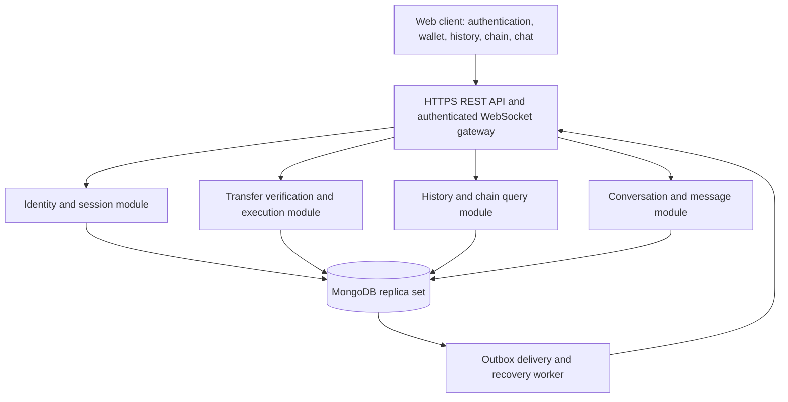

# Secure P2P Asset Transfer System — High-Level Design

Status: Approved by the user on 24 October 2026. Project foundation complete; feature implementation pending.
Date: 24 October 2026

## 1. Objective and proposed scope

Build a web application where registered peers can transfer simulated assets, review their transfer history, inspect a verifiable transfer chain, and exchange direct messages. The backend enforces authorization, validation, persistence, and atomic execution.

Proposed MVP assumptions, subject to approval:

- Assets are fungible simulated units with a configured precision, such as demo credits. Physical assets, unique items, real payments, and cryptocurrency settlement require a different ownership or settlement model.
- P2P describes transfers and conversations between users. A trusted application server coordinates all authoritative writes; this is not a decentralized network.
- Each transfer settles immediately after verification. Recipient acceptance, escrow, fees, and scheduled transfers are future features.
- The asset transfer chain is a hash-linked audit trail. It does not implement mining, public consensus, or blockchain settlement.
- Connectivity to the server is required to finalize transfers and deliver messages. Offline transfers and conflict resolution are outside the MVP, despite the workspace name.
- Demo balances come from controlled development fixtures. Public users cannot mint credits. Fixtures record balanced issuance from a designated system account; a production issuance workflow is a separate feature.

## 2. Architecture

Use a modular monolith initially: one backend deployment with clear module boundaries and a separate background worker using the same codebase. This keeps the critical write path inside one database transaction and avoids distributed transaction coordination.

Suggested stack: React and TypeScript for the client; Node.js, TypeScript, and NestJS for backend modules; MongoDB with its official driver for persistence; Socket.IO for server-mediated chat and transfer notifications; Docker Compose for local infrastructure. Pin supported versions during implementation.

MongoDB must run as a replica set for multi-document transactions. Use a development replica set locally and a redundant replica set or Atlas deployment for production. Redis and additional backend replicas can be introduced later if connection counts and measured load justify them.

## 3. Modules and user experience

| Module | User capabilities | Backend responsibilities |
| --- | --- | --- |
| Authentication / Sign Up / Sign In | Register, sign in, sign out, see active identity | Password hashing, session creation and revocation, validation, login throttling |
| Wallet and Transfer | See balances, select a peer and asset, enter quantity, confirm transfer | Resolve sender from session, verify recipient and balance, prevent duplicate execution, commit transfer |
| Asset Transfer Log | Browse sent and received transfers; filter by asset, status, date, peer | Participant-scoped queries, cursor pagination, durable outcome and safe rejection reasons |
| Asset Transfer Chain | Inspect a transfer's predecessor, sequence, hashes, and verification result | Append chain entries atomically, verify continuity and content, protect private details |
| Peer-to-Peer Chat Window | Open a direct conversation, send text, view history and delivery state | Membership checks, message persistence, duplicate suppression, real-time delivery and reconnect recovery |

Proposed screens: sign up/sign in; dashboard with balances and recent activity; transfer form and confirmation; searchable transfer log and detail view; chain detail view; direct chat window. Transfer confirmations show recipient, asset, quantity, and final outcome.

Peer lookup uses exact public handles and returns minimal profile information. Users cannot read another user's wallet, private history, chain details, or conversations. Full chain verification is an internal maintenance operation; the UI exposes participant-authorized transfer details and limited predecessor hash metadata.

## 4. Multi-stage transfer verification and atomic execution

1. **Authenticate:** validate the session; derive sender identity on the server.
2. **Validate input:** require a recipient, supported asset, positive quantity, configured precision, and an idempotency key. Reject self-transfers, malformed identifiers, unknown fields, and values outside supported limits.
3. **Register the request:** persist a unique `(senderId, idempotencyKey)` request and a canonical payload hash. Replays of the same payload return the existing result or pending state. The same key with different content returns a conflict.
4. **Check eligibility:** resolve the recipient and accounts. Check account status and asset support. Recheck mutable conditions inside the execution transaction; account suspension and other eligibility changes must coordinate through the account documents involved in transfers.
5. **Execute one MongoDB transaction:** claim the pending transfer through a conditional write; revalidate eligibility; conditionally debit the sender only if sufficient balance exists; credit the recipient subject to numeric limits; insert balanced debit and credit ledger entries; append the chain entry and advance its head; mark the transfer committed; insert its outbox event. All operations use the same database session.
6. **Acknowledge the result:** return success only after the commit is confirmed. A worker publishes notifications after commit. Clients reconcile through the persisted transfer status if a response or notification is lost.

Balances use signed 64-bit integer base units with explicit bounds and overflow checks. API quantities are decimal strings; parsing and arithmetic use exact integer representations, never floating-point balances.

Use snapshot read concern and majority write concern for execution transactions. Conditional balance updates prevent concurrent requests from spending the same available balance. Shared chain-head updates also produce write conflicts; the driver retries eligible transactions with bounded retry policy. Keep network calls and message emission outside transaction callbacks because callbacks may run more than once.

Transfer states: `PENDING -> COMMITTED` or `PENDING -> REJECTED`. Verification stages are checks, not separately committed financial states. A business rejection stores a stable reason after any execution transaction is aborted. Infrastructure failures leave a retryable pending request. A recovery worker retries pending requests using the same transfer identity and conditional state transition. Rejecting a request must also conditionally match `PENDING`, so it cannot overwrite a committed result.

For an unknown commit outcome, retry commit or reconcile persisted state using the same request identity. Do not report a definite rejection or initiate a new transfer merely because the connection timed out. Users can query status and safely repeat the original request.

Core invariants:

- Ordinary user balances never become negative.
- Each committed transfer has equal debit and credit quantities in the same asset.
- A request identity produces at most one committed financial effect.
- Every committed transfer has its ledger pair, chain entry, and outbox event.
- Rejected transfers have no balance, ledger, or chain effects.
- Completed transfers are not edited or deleted through the application. Future corrections use explicit compensating transfers.

## 5. MongoDB data model and indexes

| Collection | Main fields | Planned indexes |
| --- | --- | --- |
| `users` | normalizedEmail, publicHandle, passwordHash, status, timestamps | Unique normalized email; unique normalized handle |
| `sessions` | userId, tokenHash, expiresAt, revokedAt | Unique tokenHash; userId; TTL expiresAt |
| `assetTypes` | code, displayName, precision, status | Unique code |
| `accounts` | userId, assetId, balanceUnits, status | Unique `(userId, assetId)` |
| `transfers` | senderId, recipientId, assetId, quantityUnits, idempotencyKey, payloadHash, status, rejectionCode, timestamps | Unique `(senderId, idempotencyKey)`; `(senderId, createdAt desc, _id desc)`; `(recipientId, createdAt desc, _id desc)`; `(status, createdAt)` for recovery |
| `ledgerEntries` | transferId, accountId, assetId, side, quantityUnits, createdAt | Unique `(transferId, side)`; `(accountId, createdAt desc, _id desc)` |
| `chainEntries` | assetId, sequence, transferId, previousHash, entryHash, canonicalPayload, createdAt | Unique `(assetId, sequence)`; unique transferId |
| `chainHeads` | assetId, latestSequence, latestHash | Unique assetId |
| `conversations` | canonicalPairKey, participantIds, createdAt, lastMessageAt | Unique canonicalPairKey; `(participantIds, lastMessageAt desc, _id desc)` |
| `messages` | conversationId, senderId, clientMessageId, text, createdAt | Unique `(conversationId, senderId, clientMessageId)`; `(conversationId, createdAt desc, _id desc)` |
| `outboxEvents` | eventId, eventType, aggregateId, payload, nextAttemptAt, attempts, deliveredAt | Unique eventId; `(deliveredAt, nextAttemptAt)` |

MongoDB validators enforce required types and allowed enums; application validation enforces business rules. Create collections and indexes before accepting traffic. TTL expiry is housekeeping: session validity is checked directly on every request because deletion is asynchronous. Retain transfer identities and outcomes for the history retention period so idempotency remains effective.

Use cursor pagination with a timestamp and unique ID tie-breaker, bounded page sizes, and projections. Start with these indexes; add filter-specific compound indexes only after measuring query plans. Balances are maintained atomically with the append-only ledger and can be checked against it by a reconciliation job.

## 6. Transfer-chain integrity

Maintain a separate chain per asset type, with a defined genesis hash and consecutive sequence numbers. Hash a versioned canonical payload containing the sequence, transfer ID, sender and recipient account IDs, asset ID, exact quantity, committed timestamp, and previous hash using SHA-256. Store that same canonical representation for later verification.

Within the transfer transaction, conditionally advance the asset's chain head from the previously read sequence/hash. Concurrent writers conflict and retry; no two committed entries may claim the same sequence.

A verification job checks hash recomputation, predecessor links, consecutive sequences, head agreement, and correspondence with committed transfers and ledger entries. One head per asset serializes that asset's appends and is an intentional MVP throughput constraint.

This structure detects modifications against a trusted retained checkpoint. A privileged actor able to rewrite the database could also recompute the chain; externally retained signed checkpoints would be needed for stronger evidence. Checkpoint anchoring and administrator-resistant audit storage are future work.

## 7. Authentication, authorization, and chat

- Hash passwords with Argon2id and an established library. Never persist plaintext passwords or log credentials.
- Use opaque, revocable sessions stored as hashes in MongoDB. Send the token in an HttpOnly, Secure, SameSite cookie. Enforce CSRF protection for state-changing HTTP requests and a strict origin allowlist for WebSocket connections.
- Enforce resource authorization on each REST request, socket subscription, and message action. Expired or revoked sessions must lose socket access as well as HTTP access.
- Use TLS for deployed HTTP and WebSocket traffic. Keep database credentials and session secrets outside source control; grant the application only necessary database privileges.
- Validate message shape and length, rate-limit logins/transfers/chat, cap connections, and render user text safely. Do not log session tokens or private chat contents.
- Persist a chat message and its delivery event in one transaction before acknowledging acceptance. Retry client sends with a stable clientMessageId. Reconnect through paginated message history to recover gaps.
- Outbox delivery is at least once. Event IDs and client deduplication handle repeated events; a gateway publish acknowledgement does not prove that a user read a message. Read receipts can be added later.
- MVP chat is encrypted in transit and subject to the database deployment's storage protections; the server can read message text. End-to-end encryption requires a separate identity, key management, and recovery design.

## 8. API and event boundaries

| Boundary | Proposed endpoints or events |
| --- | --- |
| Identity | `POST /auth/signup`, `POST /auth/signin`, `POST /auth/signout`, `GET /auth/me` |
| Peers and balances | `GET /peers?handle=...`, `GET /accounts` |
| Transfers | `POST /transfers` with `Idempotency-Key`, `GET /transfers`, `GET /transfers/:id` |
| Chain | `GET /transfers/:id/chain` with participant authorization |
| Conversations | `POST /conversations`, `GET /conversations`, `GET /conversations/:id/messages` |
| Socket client actions | `conversation.join`, `message.send` |
| Socket server events | `message.created`, `transfer.updated` |

HTTP responses distinguish authentication failures, authorization failures, validation errors, idempotency conflicts, pending outcomes, and confirmed business rejection. Socket acknowledgements include stable IDs for reconciliation. Room membership is assigned only after server-side authorization.

## 9. Deployment, reliability, and validation

Local topology: web client, API, outbox/recovery worker, and a MongoDB replica set. Production adds TLS termination, redundant database members, managed secrets, backups with restore drills, health checks, and centralized metrics. Run backups with restricted access and defined retention.

Monitor transfer latency and outcomes, transaction retries/conflicts, pending-request age, outbox backlog, chain verification results, authentication failures, and socket connection counts. Use structured request/transfer correlation IDs without private payloads.

Proposed acceptance envelope to validate, not a measured performance claim: 100 simultaneous connected peers, 10 transfers per second, and p95 transfer/history API latency below 500 ms on documented test hardware. Measure chain-head contention and adjust targets or architecture based on results. Availability and recovery objectives must be set before production deployment.

Required verification:

- Successful transfers update both balances, both ledger entries, chain, and outbox together.
- Concurrent transfers cannot overspend; duplicate and conflicting idempotency requests behave correctly.
- Failure injection before commit leaves no partial financial effects; connection loss around commit reconciles safely.
- Worker restarts and duplicate events do not create duplicate transfers or stored messages.
- Reconciliation detects balance/ledger mismatch; chain verification detects changed, missing, and inconsistent entries.
- Users cannot access another user's records or conversations; revoked sessions cannot continue using sockets.
- Socket reconnect recovers messages; query plans and load tests meet the agreed acceptance envelope.

## 10. Implementation sequence after approval

1. Scaffold the client/backend, local MongoDB replica set, validation, schemas, and indexes.
2. Implement sign up/sign in, sessions, peer lookup, wallets, and balanced demo fixtures.
3. Implement transfer validation, idempotency, atomic ledger/balance updates, and failure/concurrency tests.
4. Add the hash chain, authorized transfer history/detail screens, and reconciliation checks.
5. Implement direct chat, transactional outbox, socket notifications, and recovery.
6. Complete the UI, security checks, deployment documentation, and measured performance validation.

Approved scope: server-coordinated simulation, fungible demo assets, immediate settlement, the TypeScript stack, a MongoDB replica set, a hash-linked audit chain, and server-mediated chat. Current implementation is limited to the project structure and prerequisite setup requested after approval.

## References

- [MongoDB transactions](https://www.mongodb.com/docs/manual/core/transactions/) — multi-document atomicity and transaction concerns.
- [MongoDB transaction production considerations](https://www.mongodb.com/docs/manual/core/transactions-production-consideration/) — replica set requirements and operational constraints.
- [OWASP WebSocket Security Cheat Sheet](https://cheatsheetseries.owasp.org/cheatsheets/WebSocket_Security_Cheat_Sheet.html) — origin checks, session handling, action authorization, validation, and rate limiting.
- [OWASP Authentication Cheat Sheet](https://cheatsheetseries.owasp.org/cheatsheets/Authentication_Cheat_Sheet.html) — authentication and session security guidance.
