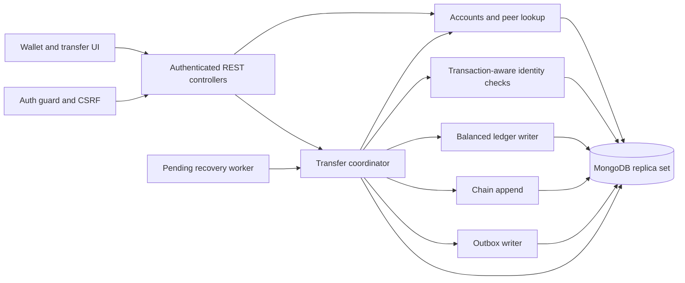
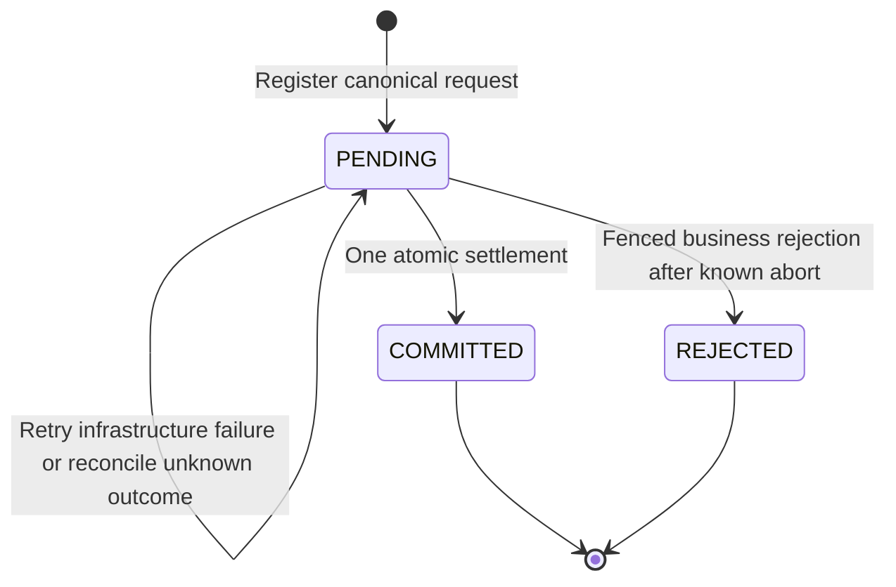

# Wallet and Transfer module HLD

Next design: use the [overhaul HLD](WALLET_ASSET_OVERHAUL_HLD.md) and [LLD](WALLET_ASSET_OVERHAUL_LLD.md) for the requested UI-configurable assets, explicit wallets, custody and dual settlement implementation. This document remains the v1 simulation baseline; the overhaul is not implemented.

Status: Module HLD, 24 October 2026. The user authorized implementation after this design was written. See the concrete [LLD](WALLET_AND_TRANSFER_LLD.md), [QA map](WALLET_AND_TRANSFER_QA.md) and [onboarding](../onboarding.md) for implementation and actual verification status. The parent [approved HLD](HIGH_LEVEL_DESIGN.md) remains the scope authority; proposals below are resolved by the LLD where specified.

Read the [LLD and implementation handoff](WALLET_AND_TRANSFER_IMPLEMENTATION.md) before coding. It defines deliverables, source changes, sequencing, and acceptance gates for the next model.

## 1. Purpose and verified starting point

Let an authenticated user view simulated asset balances, find a peer by exact public handle, review a transfer, submit it once, and recover its authoritative outcome after interruptions. The trusted server owns all eligibility checks and settlement. No real money, blockchain settlement, fees, escrow, recipient acceptance, public minting, or offline settlement is included.

Historical starting point: repository inspected on `feature/Auth` at `aa208f7` on 24 October 2026; the working tree was clean before the design session. The table below describes that baseline, not the current implementation. Recheck live state and the LLD when continuing work.

| Area             | Implemented today                                                                  | Work required                                                                |
| ---------------- | ---------------------------------------------------------------------------------- | ---------------------------------------------------------------------------- |
| Identity         | Email/Google authentication, `AuthGuard`, session-bound CSRF, active-user checks   | Reuse guards; add transaction-aware eligibility integration                  |
| Persistence      | `DatabaseService.client` and `.db`, replica-set readiness                          | Domain collections, validators, indexes, transaction executor                |
| Domain modules   | Empty Accounts, Transfers, Ledger, and Chain modules imported by `AppModule`       | All services, stores, controllers, and domain logic                          |
| Web              | `App.tsx`, `AuthPanel.tsx`, auth API helper; identity state lives inside AuthPanel | Shared session state, wallet, peer lookup, transfer confirmation and outcome |
| Shared contracts | Health and authentication types                                                    | Wallet, peer, transfer, and error contracts                                  |
| Workers          | README placeholder only                                                            | Pending recovery; durable outbox storage; later socket delivery              |
| Tests            | Health/auth unit and executable Cucumber suites                                    | Wallet/transfer unit and functional coverage                                 |

At that baseline no wallet routes, issuance scripts or transfer workers existed. Implementation now follows the LLD; no additional environment settings are introduced apart from the explicit CLI's `DEMO_PASSWORD` prerequisite.

## 2. Responsibilities and boundaries

Wallet and Transfer is a user-facing module spanning the existing backend boundaries. Do not create a second wallet balance store alongside Accounts.

| Owner           | Responsibilities                                                                                                         | Exclusions / integration                                                        |
| --------------- | ------------------------------------------------------------------------------------------------------------------------ | ------------------------------------------------------------------------------- |
| Accounts        | Asset catalogue, zero account provisioning, own balances, exact peer lookup, eligibility and conditional balance updates | No independent debit/credit endpoint; Auth owns users                           |
| Transfers       | Strict input, request identity, state machine, execution orchestration, participant-authorized status lookup             | Sole coordinator of user settlement; no direct notification publishing          |
| Ledger          | Append balanced journal pairs, reconciliation against balances                                                           | Never mutate historical journal entries or set balances to repair discrepancies |
| Chain           | Canonical transfer hashing and atomic per-asset head advancement                                                         | No public consensus; full verification remains internal                         |
| Workers         | Retry pending requests; preserve durable events for later at-least-once delivery                                         | Reuse the same transfer executor; never implement a second settlement algorithm |
| Auth            | Identity, sessions, CSRF; active-user eligibility adapter                                                                | No asset issuance during sign-up or sign-in                                     |
| Web / contracts | Typed presentation, confirmation, stable retry identity, reconciliation                                                  | Browser balance checks are advisory only                                        |

All settlement writes use one `ClientSession` from the existing MongoDB client. Accounts, Ledger, Chain, and the outbox writer accept that session explicitly and never start nested transactions. Only the coordinator owns commit/abort.

## 3. User flows

1. After session restoration, show each configured asset's code, name, precision, exact balance and availability. An active user without a stored account sees zero; reading a wallet does not mint assets or create persistence records. An empty asset catalogue shows an explicit empty state.
2. Resolve a trimmed, normalized exact public handle. Return only peer ID, handle and display name. Do not reuse the `AuthUser` response: it includes email. Do not offer email lookup or broad user enumeration.
3. Select an asset and enter a decimal string. Resolve the recipient before confirmation; retain the immutable peer ID. Show recipient, asset and exact amount on a review screen. Changing any of these invalidates the review.
4. On explicit confirmation create one random idempotency key for this intent. Freeze the canonical request and key while the result is unresolved. Disable repeated clicks, but rely on server idempotency for correctness.
5. Display committed only after an authoritative committed response. A rejected transfer shows its stable safe reason. Pending or network timeout means the outcome is unresolved, never a confirmed failure. Reconcile by ID when known or repeat the same POST with the same key and payload when the response was lost.
6. Refresh wallet and transfer detail after a terminal result. Do not optimistically subtract a balance. Restore an unresolved intent after a reload in the same tab, scoped to the signed-in user; clear it on sign-out/account change. No authentication tokens belong in browser storage. Never send a stored intent under a different user.

Proposed UI scope includes balances, exact peer lookup, review, result, and resuming one unresolved intent per tab. Full searchable transfer history and chain explorer screens belong to later modules. Their backing ledger/chain writes are required immediately.

## 4. Amount and eligibility rules

- API quantities are strings; internal arithmetic uses `bigint`; MongoDB stores BSON signed 64-bit integers. Do not pass balances, quantities or sequences through JavaScript `number`, `parseFloat`, or a BSON conversion that silently promotes large integers to doubles.
- Proposed asset precision is an immutable integer from 0 to 8. Parse a bounded ASCII decimal string with no sign, exponent, grouping commas, whitespace, or incomplete decimal point. Reject more fractional digits than precision, including surplus zero digits. Require strictly positive transfer units and at most `9223372036854775807` units. Zero balances are valid.
- Canonical request identity uses integer unit strings, not display strings: for precision 2, `1`, `1.0`, and `1.00` all mean `100` units. Format API balance/quantity values at the asset's fixed precision. Set input length bounds before expensive parsing; pin exact grammar and examples in LLD.
- An ordinary balance is in `[0, INT64_MAX]`. Conditional debit requires active account and `balanceUnits >= quantityUnits`; conditional credit requires active account and `balanceUnits <= INT64_MAX - quantityUnits`. Check exact conversions and both bounds before writing.
- Reject self-transfer, unavailable peer, inactive user/account, disabled asset, and unsupported asset. No email-verification prerequisite is introduced: existing email users are explicitly unverified.
- Zero account provisioning is idempotent under the unique user/asset key and occurs inside the execution transaction for eligible participants. A missing sender account therefore has zero and cannot spend; a recipient can receive without first visiting the wallet. If settlement rejects, abort provisioned accounts along with other transaction writes.
- Eligibility reads alone do not synchronize suspension with settlement. Proposed solution: a transaction-aware Auth adapter performs a real revision increment conditional on active status for both user records; Accounts updates the account records; Chain's head update also carries the asset's transfer-enabled state. Future user/account/asset suspension must update those same records through coordinated services. Define this ordering and test races in LLD. Direct administrative edits are outside the supported write path.
- Existing assets cannot change precision or identity after use. Asset disabling updates its catalogue record and chain-head eligibility in one transaction; no supported enable/disable path may leave those flags inconsistent.

The user/asset eligibility writes add contention deliberately to make suspension ordering enforceable. A transfer that commits before suspension may settle; one ordered after it must reject. Session validity is checked at HTTP admission. A durably admitted request remains eligible for recovery after the browser signs out, subject to current participant/account/asset eligibility; logout is not transfer cancellation.

## 5. Proposed persistence and indexes

These are target schemas; no migration has run. Keep existing Auth collections intact and use explicit validators and projections. Immutable references use ObjectIds internally and lowercase hex strings over HTTP. All dates are server UTC timestamps.

| Collection / owner                       | Fields beyond `_id`                                                                                                                                                                  | Required indexes / constraints                                                                                                                   |
| ---------------------------------------- | ------------------------------------------------------------------------------------------------------------------------------------------------------------------------------------ | ------------------------------------------------------------------------------------------------------------------------------------------------ |
| `assetTypes` / Accounts                  | `code`, `displayName`, `precision`, `status`, timestamps                                                                                                                             | Unique code; immutable precision/code after issuance                                                                                             |
| `accounts` / Accounts                    | `ownerType: user or system`, optional `userId`, optional `systemKey`, `assetId`, `balanceUnits`, `status`, timestamps                                                                | Unique partial `(userId, assetId)` for users; unique partial `(systemKey, assetId)` for systems; validator enforces exactly one owner form       |
| `transfers` / Transfers                  | `senderId`, `recipientId`, `assetId`, `quantityUnits`, `idempotencyKey`, `payloadVersion`, `payloadHash`, `status`, nullable `rejectionCode`, timestamps; attempt/lease fields below | Unique `(senderId, idempotencyKey)`; sender/time/ID and recipient/time/ID descending; `(status, nextAttemptAt, _id)` for recovery                |
| `ledgerEntries` / Ledger                 | `referenceKind: transfer or demoIssuance`, `referenceId`, `accountId`, `assetId`, `side: debit or credit`, positive `quantityUnits`, `createdAt`                                     | Unique `(referenceKind, referenceId, side)`; `(accountId, createdAt desc, _id desc)`; exactly two opposite equal entries per committed reference |
| `demoIssuances` / Accounts orchestration | Stable `fixtureKey`, `assetId`, system and recipient account IDs, exact units, timestamp                                                                                             | Unique fixture key; atomic balanced journal; no HTTP creation endpoint                                                                           |
| `chainEntries` / Chain                   | `assetId`, BSON Long `sequence`, `transferId`, `previousHash`, `entryHash`, `canonicalVersion`, `canonicalPayload`, `createdAt`                                                      | Unique `(assetId, sequence)`; unique `transferId`                                                                                                |
| `chainHeads` / Chain                     | `assetId`, BSON Long `latestSequence`, `latestHash`, `transfersEnabled`                                                                                                              | Unique asset ID; initialized with catalogue before traffic                                                                                       |
| `outboxEvents` / Workers                 | Stable `eventId`, `eventType`, `aggregateId`, `schemaVersion`, minimal participant payload, `nextAttemptAt`, `attempts`, nullable `deliveredAt`                                      | Unique event ID; `(deliveredAt, nextAttemptAt)`; never mark delivered merely because no transport exists                                         |
| `users` / Auth integration               | Proposed optional `transferEligibilityRevision`, incremented on eligibility fencing                                                                                                  | Backfill/default-zero semantics for existing users; keep Auth's existing indexes and validators compatible                                       |
| `transferRateLimits` / Transfers         | Hashed caller/window key, counter, `expiresAt`                                                                                                                                       | Unique key and TTL expiry; separate limits from authentication                                                                                   |

`transfers` also needs `attemptToken`, `leaseUntil`, `attempts`, and `nextAttemptAt`; specify nullable/default states and validation in LLD. Retain terminal transfers and their request identities indefinitely for the MVP; no TTL on transfers, ledger, chain, or issuance. A future retention policy must preserve duplicate suppression.

This refines two parent-HLD sketches: system issuance needs an owner distinct from an authenticatable user, and ledger entries need a typed journal reference so issuance is audited without pretending it was a user transfer. Ledger balance reconciliation includes both reference kinds. The transfer chain contains user transfers; issuance is explicitly outside that chain and remains in its immutable journal. If issuance must be hash-chained later, version that schema deliberately.

## 6. API and event contract

All proposed routes use `/api`, require `AuthGuard`, and send `Cache-Control: no-store`. Every POST additionally calls existing `requireCsrf(request, environment, request.auth.token)`. `AuthGuard` alone does not check CSRF. Reject unknown body/query fields and validate identifiers before database queries.

| Route                   | Proposed request                                               | Proposed response / authorization                                                                                                                |
| ----------------------- | -------------------------------------------------------------- | ------------------------------------------------------------------------------------------------------------------------------------------------ |
| `GET /accounts`         | No caller-supplied user ID                                     | `{ accounts: [{ assetId, code, displayName, precision, balance, status }] }`; own wallet only; virtual zero rows have the same asset-based shape |
| `GET /peers?handle=...` | Exact normalized public handle                                 | `{ peer: { id, publicHandle, displayName } }`; active peers only; unavailable/missing peer returns generic 404                                   |
| `POST /transfers`       | `Idempotency-Key`; strict `{ recipientId, assetId, quantity }` | `{ transfer }`; sender always from session; terminal/pending semantics below                                                                     |
| `GET /transfers/:id`    | Transfer ID                                                    | `{ transfer }` for sender; recipient may see only committed transfers; unknown or unauthorized ID returns the same 404                           |

`transfer` projects only ID, sender/recipient public identities, asset identity/precision, canonical decimal quantity, status, safe rejection code and timestamps. Never return payload hashes, request keys, attempt leases, private identity fields, raw errors, or system-account details. Pin whether display names are snapshots or current projections in LLD; IDs and quantity are immutable either way.

Proposed stable HTTP semantics:

- `201`: newly registered transfer confirmed committed. `200`: replay of committed result or authorized status read (including pending/rejected status reads).
- `202`: durable pending transfer; return ID and polling guidance. Pending is not acceptance of settlement. If registration itself cannot be confirmed, use `503` and require a same-key retry; do not invent a durable ID.
- `422`: POST reached a persisted business rejection, including replay of that same rejected request; return the same transfer ID and reason. Suggested codes: `INSUFFICIENT_BALANCE`, `RECIPIENT_UNAVAILABLE`, `ACCOUNT_UNAVAILABLE`, `ASSET_UNAVAILABLE`, `BALANCE_LIMIT_EXCEEDED`.
- `400`: malformed shape/key/ID/quantity, unsupported asset identifier, or self-transfer before request registration. These do not create a transfer. LLD must freeze the boundary between syntax rejection and durable business rejection.
- `401` invalid/expired session; `403` origin/CSRF failure; `409 IDEMPOTENCY_CONFLICT` when a stored key has different canonical content; `429` admission throttling; sanitized `503` infrastructure unavailability.

Proposed idempotency keys are UUIDs generated once per confirmed intent. Canonical hash covers version, sender ID, recipient ID, immutable asset ID and quantity unit string. Enforce the unique key in MongoDB, catch duplicate registration races, and compare the persisted canonical payload before returning its state. Resolve existing identities before mutable eligibility checks so disabling a peer does not change a historical replay result. Never return another sender's transfer for the same key.

`transfer.updated` has a stable event ID, schema version, transfer ID, status, participant IDs and timestamp. The initial slice emits a committed event within settlement; rejected outcomes are available to the sender through REST and do not produce an event. Any later rejected-event extension must define its audience and write it atomically with rejection finalization. No client-controlled room destinations. At-least-once delivery and event-ID deduplication are required when sockets are added; HTTP remains authoritative meanwhile.

`GET /transfers` filtering/pagination and `GET /transfers/:id/chain` remain later Log/Chain API work. Reserve their parent-HLD routes but do not claim them implemented by this slice.

## 7. Settlement, idempotency and recovery

### Admission and execution

1. Authenticate, check origin/CSRF, rate limits, and bounded strict input. Canonicalize using immutable asset metadata. Persist `PENDING` under majority acknowledgement with the unique sender/key constraint. If the insert outcome is unknown, reconcile that identity before deciding anything else.
2. Claim a due pending request with a new attempt token and finite lease using a conditional write outside the execution transaction. A request already leased by another executor returns pending; leases provide scheduling, not financial correctness. Both HTTP and recovery use this path.
3. Start a transaction using primary reads, snapshot read concern and majority write concern. Re-read and conditionally update the pending request matching the attempt token to establish a real write fence. Validate current participant eligibility and ensure zero accounts; check asset/head eligibility. Lock participants in deterministic ID order.
4. Conditionally debit sender, conditionally credit recipient, insert exactly two journal entries, append canonical chain entry and conditionally advance the head, set transfer `COMMITTED`, and insert one stable outbox event. Every operation must receive the same session and run sequentially.
5. Acknowledge committed only after commit confirmation. Transaction callbacks may repeat, so they contain no HTTP calls, notification sends, external mutations, or unbounded work. Use stable transfer/event identity, explicit clock inputs and versioned canonical encoding.

### Rejection, fencing and uncertain outcomes

- A domain failure aborts the entire execution transaction, including provisioning and eligibility revisions. Only after a known abort may a separate conditional update set `REJECTED`, matching `status: PENDING` and the same attempt token. If the match fails, return the authoritative state; an old executor may not reject a newer attempt.
- A lease takeover changes the attempt token on the transfer document. A stale transaction attempting settlement must conflict or fail its token condition. Lease expiry alone must never imply failed settlement. Tests must cover stale rejection and commit against takeover.
- Retry transient transaction failures through a bounded driver policy. For an unknown commit result, retry commit/reconcile using the same request identity; do not convert it to a business rejection. A pending read alone does not prove the earlier commit cannot still resolve. Fence all subsequent execution through the same transfer record.
- The recovery worker scans due `PENDING` rows, obtains a lease, and calls the same executor. Use bounded batches, backoff with jitter and shutdown handling. Persistent infrastructure errors remain pending and alertable; do not reject because a retry count or wall-clock age was exceeded.
- Outbox storage is required with the first committed transfer. Socket delivery can be added later; until then preserve undelivered events, monitor backlog and recover through REST. No fake delivery acknowledgement or destructive backlog cleanup.

The Node driver requires the same session on transaction operations, does not support parallel operations inside a transaction, and can retry callbacks. LLD must verify timeout options against the pinned local driver before selecting the bounded policy. See [MongoDB Node driver transactions](https://www.mongodb.com/docs/drivers/node/current/crud/transactions/). Eligibility fencing addresses the snapshot-read issue described in [MongoDB transaction production considerations](https://www.mongodb.com/docs/manual/core/transactions-production-consideration/).

## 8. Ledger, chain and fixture invariants

For every committed user transfer, assert together:

1. Sender and recipient are distinct and eligible at the serialized execution point.
2. User balances remain in bounds; the sum of affected balances is unchanged.
3. There is exactly one equal debit/credit journal pair, one chain entry and one committed outbox event.
4. The chain sequence is consecutive for the asset; head sequence/hash match the appended entry.
5. One sender/key produces at most one effect; terminal transfer fields are immutable.

Rejected transfers have none of those financial, ledger or chain effects. A pending request can have registration/lease metadata but no partially committed settlement. Reconciliation sums credits minus debits from all journals for every account, including system issuance, and reports discrepancies without changing historical records.

Define canonical chain version 1 in LLD with golden byte/hash vectors: fixed field order and encoding for version, sequence string, transfer ID, sender/recipient account IDs, asset ID, quantity units, committed timestamp and previous hash. Define a fixed genesis hash and starting sequence. Bind the exact serialized payload to the persisted transfer/ledger fields; store those bytes or an unambiguous string representation. Check sequence overflow. Full verification checks continuity, hashes, head agreement and journal correspondence. Privileged database rewrites still require externally retained checkpoints for stronger detection.

Controlled fixtures must be an explicit local development/test command, never startup behavior or an HTTP faucet. Provision a designated non-login system issuance account and demo assets; record each deterministic issuance key, system debit, user credit and journal pair in one transaction. Only this system account may hold a negative balance, still bounded by signed 64-bit limits. Re-running the same fixture is a no-op when content matches and a conflict when it differs. Never reset an existing user balance to a seed value. Reject production mode and non-allowlisted targets; test fixtures use unique disposable databases and synthetic identities, with no external sign-in.

## 9. Configuration, security and operations

Reuse existing `MONGODB_*`, `NODE_ENV` and `WEB_ORIGIN` configuration. No new settings have been added. LLD must specify validated names, defaults and bounds for transaction deadlines, admission/lookup rate limits, recovery batch/backoff/lease timing, and polling. Prefer a small configuration surface. A transaction deadline must fit inside its lease with margin; takeover fencing remains necessary even then.

Assets/precision belong in the controlled catalogue, not arbitrary client input or per-request environment values. Collections/validators/indexes and genesis heads must exist before enabling transfer traffic. New initialization must be compatible with existing auth-only databases and concurrent API starts; create no demo balances during migrations. Readiness should reflect required domain initialization failures rather than serving an unusable transfer endpoint.

Authorization applies to every wallet/peer/transfer read and every write. Use bounded authenticated peer lookup, per-caller transfer admission and status-read limits, minimal projections, sanitized errors, and existing secure cookie behavior. Avoid logging cookies, CSRF tokens, request payloads, emails or full idempotency keys. Record correlation IDs, transfer IDs, status/code and timings. Track retries, write conflicts, pending age, reconciliation failures and outbox backlog.

No current performance result covers settlement. The parent HLD's 10 transfers/second and p95 below 500 ms are proposed targets only. Per-asset chain heads and participant eligibility writes serialize some workload. Measure before introducing caching, partitioning or more backend replicas.

## 10. Verification and completion boundary

The required tests and work packages are detailed in the [implementation handoff](WALLET_AND_TRANSFER_IMPLEMENTATION.md). Both TypeScript unit tests with JUnit XML and executable Cucumber scenarios must cover happy, negative and edge flows. Real replica-set functional tests must observe all persisted financial effects; mocks alone cannot establish atomicity or concurrency safety.

Implementation now includes the dedicated [Accounts](ACCOUNTS.md), [Ledger](LEDGER.md), [Chain](CHAIN.md) and [Workers](WORKERS.md) boundaries. The LLD records final choices and the independent QA map records executed scenarios and remaining evidence gaps. Do not infer a successful test run from this HLD. Production issuance, full history/chain UI, sockets, external checkpoints, deployment and load validation remain separate work.
