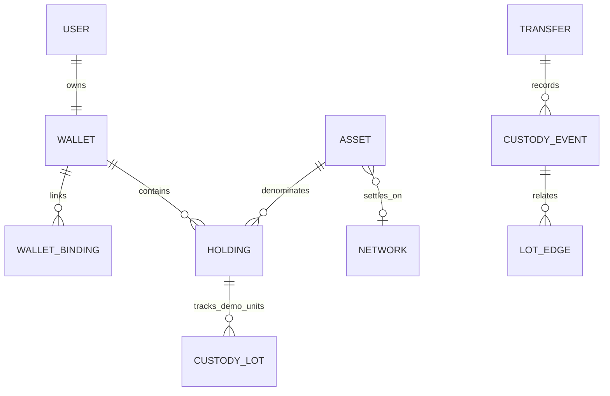
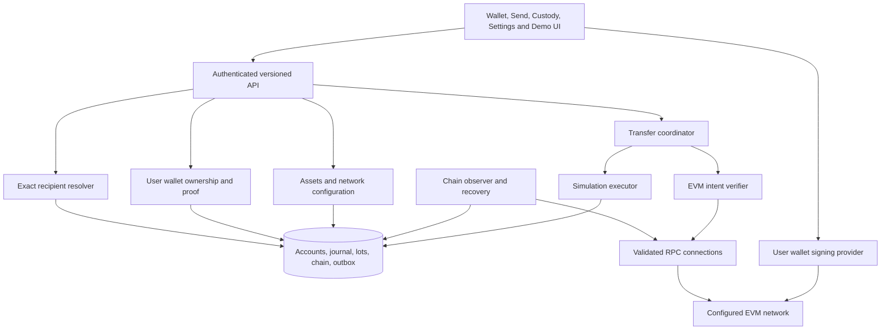

# Wallet, assets and transfer overhaul — HLD

Status: demo slice implemented, full overhaul in progress, 25 October 2026. The browser uses v2 wallet/review/send and participant custody activity. Demo asset configuration/issuance, role setup/access/audit, seed preview/run/resume and explicit local legacy migration are implemented. See [wallet architecture](WALLETS.md), [custody](CUSTODY.md), [administration](ADMINISTRATION.md) and [handover](../onboarding.md) for verified tests and live cutover evidence. Binding proofs, network/provider configuration, global policy editors, EVM settlement and testnet acceptance remain pending. Read the [LLD](WALLET_ASSET_OVERHAUL_LLD.md) for the complete target and acceptance scenarios. The existing [wallet HLD](WALLET_AND_TRANSFER.md) and [LLD](WALLET_AND_TRANSFER_LLD.md) retain v1 compatibility context.

## 1. Requirements and recommended scope

The user requested UI-configured assets, wallets linked uniquely to real registered users, validation of both transfer participants, recipient lookup, token custody history and a database populated with valid synthetic data. The user clarified that a peer is the recipient being paid: a registered user with a valid wallet, regardless of whether that user is logged in. “Real registered user” means an existing active application identity, not an assertion of legal identity or KYC. Synthetic registered users satisfy that contract in isolated demo environments.

Support both simulated and real blockchain assets through a shared product model and separate settlement engines. Recommended delivery order is demo simulation, local-chain integration, EVM testnet, then a separately enabled mainnet release. A simulated transfer must never be presented as an on-chain transaction. A single database transaction cannot atomically settle an external blockchain transfer.

| Asset type in UI    | Settlement  | Wallet and source of truth                                              | Initial scope                                                                     |
| ------------------- | ----------- | ----------------------------------------------------------------------- | --------------------------------------------------------------------------------- |
| Demo crypto         | `SIMULATED` | Application wallet; MongoDB balances, balanced journal and custody lots | Configurable name, symbol, precision, supply and issuance; no real monetary value |
| Decentralized token | `EVM_ERC20` | User-controlled linked EVM address; canonical chain state               | Allowlisted ordinary ERC-20 contracts; local chain/testnet first, mainnet gated   |

Demo tokens may imitate crypto display conventions but must carry a permanent “Demo · simulated” label. Testnet and mainnet have separate network labels and asset IDs even when symbols match. No automatic conversion, bridge or shared balance exists between demo and on-chain assets. Support for native-coin transfers, NFTs, other chain families, smart-contract wallets, fee-on-transfer and rebasing tokens requires an additional adapter/design. Native gas balance is displayed for ERC-20 sending, but native-coin transfers are not part of this release.

## 2. Domain model and invariants

- Each user has one durable application wallet ID. Multiple assets live in that wallet. A user may additionally link one EVM address per configured network; each network/address belongs to one user for its lifetime in this release. Unlinking revokes use, not ownership history or uniqueness. Wallet IDs and historical owners are never reassigned.
- Internal system issuance accounts are not users, recipients or external wallet bindings. Existing account balances remain the simulation balance store; a wallet is an ownership envelope, not a second mutable balance ledger.
- Both participants must be active, different registered users with distinct active application wallets. On-chain participants must also have distinct, verified active bindings on the selected network. Address syntax alone never proves ownership. Recipient login or online presence is irrelevant.
- The server derives the sender from the session. Clients cannot choose a sender user or substitute a recipient address after review. Eligibility is rechecked at settlement for demo transfers and before preparation/submission for on-chain requests.
- Demo quantities retain exact int64 base units; chain quantities require uint256-safe decimal strings and bigint arithmetic. No floating-point balances. Chains and journal records are append-only; corrections use explicit new events.
- “Tokens have a chain of custody” means complete lot provenance for simulated holdings, including issuance, splits and merges. Fungible ERC-20 units have no serial number: show verifiable transfer-event history and its indexed coverage, not invented ownership of individual coins. External deposits and history before indexing are clearly marked boundaries. Supporting uniquely identifiable real tokens later would require NFTs or a custom token protocol.

## 3. Components and integration

Retain the React/TypeScript client, NestJS modular API, existing auth/CSRF controls, MongoDB replica set, exact quantities, durable idempotency, transfer recovery and outbox. Add modules within the existing deployment before considering separate services.

| Boundary                 | Responsibility and source integration                                                                                                                     |
| ------------------------ | --------------------------------------------------------------------------------------------------------------------------------------------------------- |
| Assets                   | Extract catalogue/configuration ownership from `accounts`; immutable asset identities, versioned policy, network verification, admin authorization/audit  |
| Wallets                  | Application wallet provisioning, chain-address ownership challenges, unique bindings, status and eligibility fencing; Auth remains identity/session owner |
| Accounts                 | Keep existing simulated accounts and bounded updates; add wallet references and custody reconciliation                                                    |
| Peers                    | Exact handle or wallet-reference lookup joined to registered users and eligible wallets; no independent peer identity database                            |
| Transfers                | Preserve simulated executor; route v2 requests to simulation or EVM lifecycle without conflating committed states                                         |
| Custody / Chain / Ledger | Add demo lots and lineage; retain existing transfer hash chain and journal; index on-chain facts separately                                               |
| Workers                  | Existing pending recovery plus durable chain observation, reorg reconciliation, configuration verification and seed jobs                                  |
| Web                      | User wallet/link/send/history flows and administrative configuration; retain frozen intent retries and account-switch cleanup                             |

## 4. Wallet validation and peer lookup

Provision the application wallet atomically with new registration, and backfill existing users before v2 becomes available. Sign-in never issues value. Connecting an external wallet requires fresh authenticated ownership proof, domain/network binding, expiry and a one-use challenge. The application never asks for seed phrases or private keys. Phase one supports externally owned EVM accounts only; reject contract wallets explicitly until their verification/transaction adapter exists.

Use the existing unique public-handle index for exact lookup; optionally resolve a pasted application wallet ID or exact network/address. Always join back to the registered owner and wallet binding. Return minimal public identity, compatible wallet destination and a short-lived review reference. A chain address with funds but no registered owner is not a valid peer. Disallow self-send, including alternate bindings owned by the sender. Return a generic unavailable response to avoid exposing disabled/private identities. Do not return emails, balances, sessions or online status.

**Decision:** indexed exact lookup is the initial implementation. Bloom filters add stale-state and false-positive complexity without improving correctness at the current scale. If later profiling justifies an optional filter, it is an internal hint only: both positive and negative results still reach the authoritative resolver whenever freshness cannot be proven. It never grants eligibility or replaces send-time checks. The UI can configure lookup limits and review validity, not weaken uniqueness or authorization.

## 5. Sending and custody

### Simulation

Select asset and recipient, validate both wallets, enter an exact amount, review then confirm. One MongoDB transaction fences users/wallets/configuration, debits/credits existing accounts, consumes/creates custody lots, appends lineage and existing journal/chain, commits status and writes outbox. Idempotency and worker fences retain the existing design. Pending/unknown outcomes are reconciled with the same intent. Issuance creates a provenance root; partial transfers split a lot and retain change; mixed inputs form a lineage graph.

### Blockchain

Resolve and verify both bindings, prepare an expiring transfer intent, then show network, token contract, exact destination, amount and estimated native gas cost. The user signs/sends through their wallet. The server independently verifies submitted transaction evidence against that immutable intent. Submission is not settlement: observe inclusion, canonical block and configured finality before recording `FINALIZED`. RPC failures remain unresolved. Replacement transactions and reorgs are explicit states/events; no automatic new payment after a timeout.

The chain remains authoritative even if a user bypasses the UI, a prepared destination is later disabled, or an address sends externally. App configuration cannot prevent such broadcasts. Continue observing previously authorized intents after suspension; record what actually settled and flag post-preparation eligibility changes. No claim of globally preventing duplicate external transactions or reclaiming a blockchain payment is made.

Custody UI separates demo provenance from blockchain evidence. For demo lots, show issuance, previous transfers, current owner and split/change edges. Participants see their authorized events; earlier owners are pseudonymized unless separately authorized. Admins with audit permission can inspect complete application provenance. For blockchain transfers, show block/transaction/log evidence, observation coverage, confirmations/finality and reorg annotations; do not reveal private mappings from public addresses to other registered users.

## 6. Everything configurable through the UI

“Configurable” covers all supported product policies and operations. Immutable identities, arithmetic/authorization invariants and secret deployment bootstrap are not arbitrary user-editable switches. UI explains locked fields and how to create a new asset/network identity instead.

| Screen               | User operations                                                                                            | Administrator operations                                                                                                                                                 |
| -------------------- | ---------------------------------------------------------------------------------------------------------- | ------------------------------------------------------------------------------------------------------------------------------------------------------------------------ |
| My Wallet            | View multi-asset holdings; connect, verify, revoke/reverify external address; inspect availability and gas | Inspect wallet status and ownership evidence; suspend/reactivate with reason; never impersonate ownership proof                                                          |
| Assets               | Filter enabled assets by type/network; show immutable demo/testnet/mainnet labels                          | Create draft, verify, activate, pause, archive; display metadata, precision before activation, demo cap/issuance and limits; network and contract selection              |
| Networks / Providers | See supported networks and health                                                                          | Add supported adapter network; configure approved RPC endpoint, masked credential, explorer URL, finality policy, timeout and polling; test connection before activation |
| Send                 | Recipient lookup, amount, review, confirmation and recovery                                                | Set bounded lookup/request limits, review lifetime and transfer amount limits                                                                                            |
| Custody / Activity   | Own history, lot lineage, transaction detail, pending/reorg evidence                                       | Verify integrity, view configuration audit and observation lag; start bounded reindex/verification jobs                                                                  |
| Demo Data            | Clearly marked synthetic users and demo assets                                                             | Preview and run versioned seed profile; select user count, allocations, history depth and scenario mix; inspect validation and rerun result                              |
| Access / Settings    | Own display preferences                                                                                    | Grant/revoke admin/operator/auditor permissions; optimistic concurrency and audit for every policy change                                                                |

Admin APIs enforce permissions independently of hidden UI controls. New installations use a one-time setup screen authorized by a deployment-provided setup token; an existing-user role assignment must not be based on “first registrant.” Store secrets only in a server-side encrypted secret store; UI writes/replaces secrets but never reads them back. The encryption/bootstrap root and database connection must exist before the UI can run. RPC endpoints need server-side egress restrictions against SSRF. Mainnet activation requires a separate explicit UI capability and release readiness check; a configuration edit cannot select an unimplemented adapter.

Changes are revisioned and auditable. Metadata changes do not mutate historical snapshots. Pausing stops new admission/preparation; demo execution rechecks availability; already submitted blockchain transfers continue observation. A paused network keeps its observer connection until unresolved work is reconciled. No UI operation edits balances, custody history or finalized chain evidence directly.

## 7. Valid mock data

Provide a UI-driven seed job and retain CLI access to the same domain service. Synthetic `.invalid` users, real application wallet records, valid exact quantities, balanced issuance and actual simulated transfer execution build the fixture graph. Default fixture: Alice, Bob, Carol and Dana; DEMO at precision 2 and demo DETH at precision 8; chained and partial transfers with known totals (LLD). Valid offline recipients are included without requiring sign-in.

Seed only development/test/demo targets under the existing target guard, not production. Default profiles contain valid data; negative cases use isolated test fixtures, not corruption of the ordinary demo database. Preview records target/profile/hash/counts; execute uses a stable run identity, resumable checkpoints and verifier. Reruns never reset passwords, replenish spent balances or replay completed transfers. Mock blockchain data belongs to a private local development chain using known disposable test keys and a deployed test token. Testnet/mainnet data is never invented in the database. Seeding cannot give real assets to arbitrary generated addresses.

## 8. Delivery, migration and acceptance

| Stage | Deliverable and gate                                                                                                                          |
| ----- | --------------------------------------------------------------------------------------------------------------------------------------------- |
| 1     | Contracts, validators, UI administration and wallet backfill; preserve existing IDs, balances and v1 replay identities                        |
| 2     | Demo custody lots, transfer integration, full user/admin UI and repeatable seed job; reconciliation and rollback tests pass                   |
| 3     | EVM binding and ERC-20 adapter with local-chain/provider fixtures; ownership, transaction verification, precision, nonce and reorg tests pass |
| 4     | Testnet end-to-end evidence, recovery/restart drill and UI network safeguards; no paid mainnet transactions in automated tests                |
| 5     | Explicit mainnet release gate after operational ownership, finality/provider policy, monitoring and incident runbook are validated            |

Migration uses a maintenance window to drain simulation requests, reconcile the existing ledger/chain, create one wallet per user and reconstruct provenance from issuance and transfer order where evidence is complete. Never rewrite old chain hashes or idempotency payloads. Incomplete historical evidence blocks the cutover or creates explicitly labeled imported provenance boundaries under a reviewed migration policy. Back up before changes, test on a copy, and use roll-forward once new custody transfers exist. The [LLD](WALLET_ASSET_OVERHAUL_LLD.md) gives exact compatibility rules.

Every implementation stage needs TypeScript unit tests with JUnit XML and executable Cucumber `.feature` files/steps covering happy, negative and edge cases. Include HTTP/database integration and browser coverage for all configurable operations. Acceptance requires no skipped/pending/undefined scenarios, reconciliation of all seeded demo values, valid unique wallets for both participants, custody conservation, and separate simulation/chain settlement outcomes. Performance targets remain proposals until measured; retain the existing 100-peer/10 simulated transfers per second envelope and measure lookup latency and chain observer lag independently.

## 9. Technical references

The architecture choices above are project proposals. External protocol contracts to follow during implementation:

- [ERC-4361](https://eips.ethereum.org/EIPS/eip-4361): scoped, nonce-bound signed account proof; adapt it for authenticated wallet linking without replacing existing login.
- [ERC-20](https://eips.ethereum.org/EIPS/eip-20): token transfer and balance interfaces and Transfer events; metadata can be optional.
- [Ethereum JSON-RPC](https://ethereum.org/developers/docs/apis/json-rpc/): transaction/receipt/log queries and supported block tags for chain observation.
